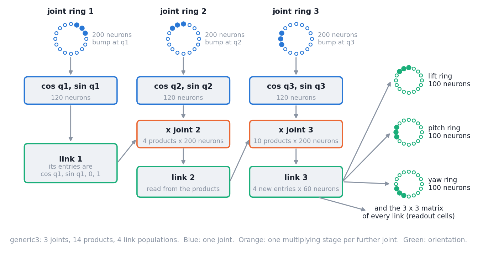
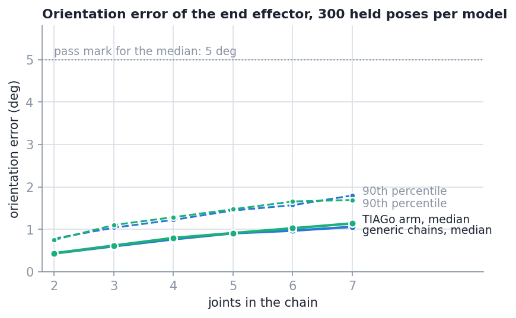
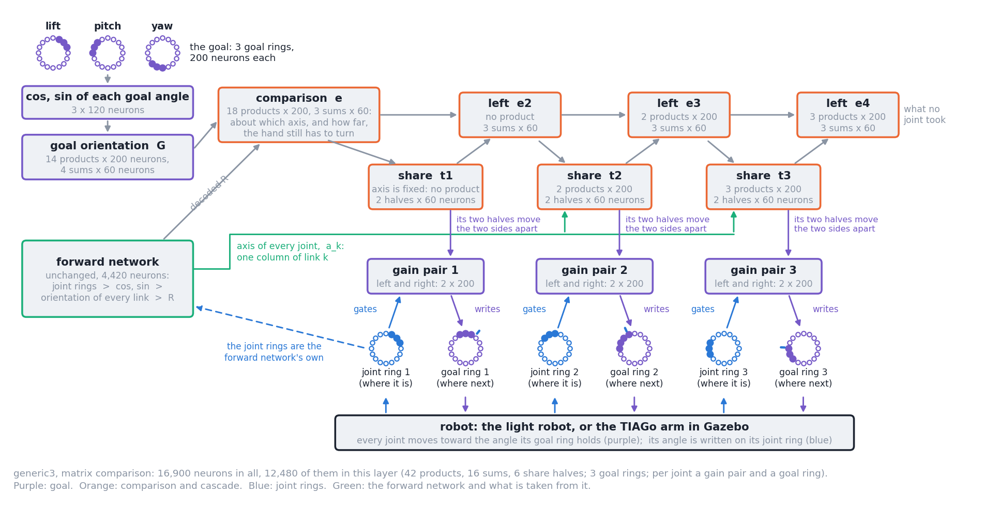

# Orientation of a robot arm, read out from ring attractors

Each joint angle of an arm sits on a spiking ring attractor (NEST) as a bump of activity. This
repo adds the network that reads the orientation of the end effector, and of every link, from
those rings: a rotation, an element of SO(3). It is built for chains of 2 to 7 joints, the
TIAGo arm among them, runs without pause, and comes with a simulator in which you move the
joints and watch the readout next to the true orientation.

This page is the run manual. The last section says where everything is.

- The mathematics and derivations of every part, how each runs as spikes, and the standard
  methods it is compared with: [`TECHNICAL.md`](TECHNICAL.md)
- How the network works: [`docs/architecture.md`](docs/architecture.md)
- The tests and their pass marks: [`docs/tests.md`](docs/tests.md)
- What came out: [`docs/results.md`](docs/results.md)
- Inverse kinematics for an orientation goal, built on top of this network: section 11 of this
  page, [`docs/ik/architecture.md`](docs/ik/architecture.md), [`docs/ik/results.md`](docs/ik/results.md)

The joint rings, and the paper draft this continues, are in the SO-2 repo
(`Ring-Attractor-SO-2-Joint-Architecture`). This repo runs on its own; it only needs the SO-2
repo to re-measure the old two-joint decoder.

## 1. What this is and what was measured



- **In:** one ring attractor per joint (the ring of the SO-2 repo, unchanged), holding the
  joint angle as a bump.
- **Between:** per joint a population that reads the cos and the sin of the angle from the
  ring; then, joint by joint, populations that multiply the orientation so far by that cos
  and sin. This is the product-feature readout of the paper, evaluated in the order whose
  cost grows by a fixed amount per joint.
- **Out:** the 3 x 3 orientation matrix of every link and of the end effector, and three
  rings whose bumps are lift, pitch and yaw.
- **Weights:** fitted once per kind of population to its measured response, the same for
  every chain. No pose of any chain is used for fitting.
- **Size:** 1,860 neurons for two joints, 16,740 for seven. The old two-joint decoder has 16,884.

### What was tested, and the result

Orientation error is the angle between the decoded and the true orientation, given as
median / 90th percentile / largest. Everything runs in NEST with a light robot (joint angles
that move toward a target at a speed limit). Full account: [`docs/results.md`](docs/results.md).

| Test | What was done | Result |
| --- | --- | --- |
| Maths | the paper's readout and the joint-by-joint order against the exact matrix product, for 14 chains; the TIAGo chain against the robot's URDF | equal |
| Parts | each kind of population in NEST, on inputs it was not fitted on | cos and sin within 0.018 (mark 0.03); a product within 0.0077 root mean square (mark 0.02); one stage turns a vector within 1.87° (mark 2°) and keeps its length within 4.7% (mark 3%: **missed**) |
| **Held poses** | 300 random poses for each of 12 models (2 to 7 joints, generic chains and the TIAGo arm): move there, hold 1 s | two joints 0.43° / 0.78° / 1.29°; seven joints 1.06° / 1.80° / 2.74° (generic) and 1.14° / 1.69° / 2.62° (TIAGo). All 12 models are within the mark set beforehand (median at most 5°, 90th percentile at most 10°) |
| Along the arm | the error of every link's orientation | 0.20° to 0.26° at the first link, 0.12° to 0.14° more per joint |
| Output rings | the lift, pitch and yaw rings against the true angles | 90th percentile at most 2.37° where the angles are defined; the lift and yaw rings fall silent near pitch = ±90°, the matrix stays right |
| **Moving arm** | the arm keeps going from goal to goal at 0.25, 0.5 and 1.0 rad/s | the readout is 0.16 to 0.20 s behind; 1 s after a stop the error is back at 0.70° to 1.19°. With the angles written ahead (option `--lead`, off by default) the 7-joint readout is 0.03 s behind and 1.80° off while moving, against 6.85° |
| All at once | the paper's order for 2 and 3 joints, on the same poses | no significant difference from joint by joint |
| **Old decoder** | the two-joint decoder of the SO-2 repo on the same 300 two-joint poses | old 4.96° / 9.72° / 18.78°, this one 0.43° / 0.78° / 1.29°; this one is closer in 99% of the poses |
| Robustness | 100 poses, 4 and 7 joints: neurons switched off, noise, smaller rings, other neurons, other encoders | 7 joints, 1.14° as built: noise 1.38°, rings of 100 neurons 1.29°, other neurons 1.03° and 0.98°. **Not robust to losing neurons**: 5.25° / 7.79° / 15.27° with 5% of the product neurons off, 15.02° / 23.43° / 30.35° with 20% |



## 2. Setup

Everything runs in the Docker image of the SO-2 repo (NEST, Python 3.8, NumPy, SciPy,
Matplotlib, ffmpeg; pinned in `docker/image.env`). Nothing is installed on the host.

**Every command on this page can be pasted into a terminal at the root of this repo as it
stands.** Each one starts a fresh container (no network), runs, and removes the container.

- `docker/run.bash nest --out /tmp/ring-so3 -- '...'` runs what is between the quotes in
  the container. Results that a command writes to `/out/...` appear on the host in
  `/tmp/ring-so3/`.
- `docker/run.bash sim -- '...'` is the same with port 8765 published on localhost (the
  simulator).
- The repo is mounted read-write at `/work`: calibration writes `artifacts/`, the report
  writes `docs/results/`. NEST uses `--threads` threads per run (default 4 or 8).

## 3. Run it

### 3.1 Calibrate

```bash
docker/run.bash nest --out /tmp/ring-so3 -- 'python3 -B scripts/calibrate.py --out /out/calibration.npz'
```

Measures every kind of population in NEST and writes its readout weights (about a minute).
The file for the default design is checked in (`artifacts/`), so nothing has to be done.
Without `--out` the command writes into `artifacts/` and replaces the file there: do that
only for a design that has none yet (`--product 400 --entry 100`, `--seed 2`,
`--encoder continuous`, `--ring 100`). The recorded results belong to the files that are
checked in.

### 3.2 Held poses of one model

```bash
docker/run.bash nest --out /tmp/ring-so3 -- 'python3 -B scripts/run_static.py --chain tiago7 --poses 20 --sweep-points 0 --out /out/tiago7.json'
```

The arm moves to each random pose, holds it for 1 s, and the readout of the last 0.5 s is
compared with the exact kinematics. Models: `generic2` .. `generic7` (axes x, y, z, x, y, z,
x; the paper's chain is `generic2`), `tiago2` .. `tiago7` (the first joints of the TIAGo arm).
The summary line is printed; every pose is in the JSON file
([`docs/results/data/README.md`](docs/results/data/README.md) explains the fields).
Without `--poses` and `--sweep-points` it runs the full test: 300 poses and a sweep of every joint.

### 3.3 A moving arm

```bash
docker/run.bash nest --out /tmp/ring-so3 -- 'python3 -B scripts/run_tracking.py --chain tiago7 --speed 0.5 --goals 5 --out /out/tracking.json'
```

The arm keeps moving from one random goal to the next at up to 0.5 rad/s per joint; every
50 ms tick is logged. With `--lead` each ring is given the angle its joint will have about
0.15 s later, which takes out the readout's delay ([`docs/results.md`](docs/results.md),
section 6). `--goal-seed N` draws other goals.

### 3.4 Variants

All are options of `run_static.py` and `run_tracking.py`:

| Option | Effect |
| --- | --- |
| `--mode flat` | all product features at once, as in the paper, instead of joint by joint |
| `--no-relay` | no link-orientation populations in the path |
| `--encoder continuous` / `corrective` | write the angle on the nearest ring index every tick / as v4's state ring does (needs that encoder's calibration) |
| `--product N --entry N --feature N --ring N` | population sizes (need their calibration) |
| `--design-seed N` | other thresholds and maximum rates (needs its calibration) |
| `--noise PA` | a noise current into every neuron between the rings |
| `--silence 0.1` | switch off this share of the product neurons (`run_static.py` only) |
| `--lead` | write each joint's angle ahead by the readout's delay (`run_tracking.py` only) |

### 3.5 The old two-joint decoder

```bash
docker/run.bash nest --so2 ../Ring-Attractor-SO-2-Joint-Architecture --out /tmp/ring-so3 -- 'python3 -B scripts/run_old_decoder.py --poses 6 --sweep-points 2 --out /out/old.json'
```

Runs the frozen legacy code of the SO-2 repo with its stored weights on the two-joint test
poses (about 10 s per pose: it rebuilds its network for every pose).

### 3.6 Everything, and the report

```bash
docker/run.bash nest --so2 ../Ring-Attractor-SO-2-Joint-Architecture -- 'python3 -B scripts/run_experiments.py --jobs 3 --threads 6'      # hours; skips runs whose output exists
docker/run.bash nest -- 'python3 -B scripts/run_parts.py --out docs/results/data/parts.json'
docker/run.bash nest -- 'python3 -B scripts/rate_study.py --out docs/results/data/rate_study.json'
docker/run.bash nest -- 'python3 -B scripts/report.py'
docker/run.bash nest -- 'python3 -B scripts/check_doc_numbers.py'
```

`run_experiments.py --list` prints the runs without starting them (70, seven of them
calibrations); a run whose output exists is skipped. `report.py` writes [`docs/results/tables.md`](docs/results/tables.md) and
`docs/results/figures/`. The last command fails if a document quotes a number that is not in
the tables.

## 4. The simulator

```bash
docker/run.bash sim -- 'python3 -B scripts/simulator.py --chain tiago7'
```

Then open <http://localhost:8765/>. The spiking network runs live, one 50 ms tick at a time,
in step with a light robot (joint angles that move toward their targets at a speed limit; no
dynamics).

- **Sliders**: one per joint, within its limits. The number beside a slider is where the
  joint is now.
- **Keep moving to random goals**: the arm goes from goal to goal by itself and rests 1 s at each.
- **One random pose**, the **joint speed limit**, and a **chain** selector (the network is
  rebuilt in about a second).
- **Write ahead**: gives each ring the angle its joint will have about 0.15 s later. Off, the
  readout trails a moving arm by that much; on, it does not.
- **The arm in 3D**, with the true frame (solid) and the frame read from the network (dashed)
  at every link and at the end effector; drag to turn the view. Below it the orientation error
  now, its median over the last 10 s, and the error of every link.
- **Lift, pitch, yaw** over the last 30 s, true and read from the output rings, and the
  orientation error.
- **Spikes** of the joint rings and of the three output rings in the last tick.

The status line says how fast the network runs; the 7-joint network needs about 8 threads to
keep up with real time (`--threads`). Other options: `--port`, `--speed`, `--mode manual`, `--lead`,
and `--stub`, which replaces the network by exact kinematics with a little noise, to try the
page where NEST is not installed (`python3 scripts/simulator.py --stub` needs only NumPy).
If your browser or proxy does not pass event streams, open `http://localhost:8765/?poll`.

## 5. Record a session

```bash
docker/run.bash nest --out /tmp/ring-so3 -- 'python3 -B scripts/record_session.py --chain tiago7 --seconds 45 --out /out/tiago7_goals'
```

Runs the goal mode without a browser and writes `tiago7_goals.mp4` (the arm with both frames,
the three angles and the error over time), `.png` (the curves of the whole session) and
`.json` (every tick). `--lead` records with the angles written ahead. The recordings of the
results page are in `docs/results/videos/`.

## 6. Tests

```bash
docker/run.bash nest --out /tmp/ring-so3 -- 'python3 -B -m unittest discover -s tests'   # about half a minute
```

Covers the maths, the wiring, the rate copy, every part of the network in NEST, a 3-joint
chain end to end, the simulator's interface, and that the documents quote only numbers from
the generated tables. What each of the ten tests of the results asks, and its pass mark:
[`docs/tests.md`](docs/tests.md).

## 7. From Python

```python
import nest
import numpy as np
from ring_so3.chains import get_chain
from ring_so3.design import Design
from ring_so3.nest import calibrate
from ring_so3.nest.network import FkNetwork

chain = get_chain("tiago7")
design = Design()
network = FkNetwork(nest, chain, calibrate.load(design), design)   # built once, then kept
q = chain.limits().mean(axis=1)                                    # seven joint angles, rad
for _ in range(40):                                                # 40 ticks of 50 ms
    tick = network.step(q)
print(tick.tool_rotation())      # 3 x 3 rotation of the end effector
print(chain.rotation(q))         # the exact one
print(tick.links.shape)          # (7, 3, 3): the raw matrix of every link
print(np.degrees(tick.angles))   # lift, pitch, yaw from the output rings
```

The same lines are in `scripts/example.py`; run them with

```bash
docker/run.bash nest -- 'python3 -B scripts/example.py'
```

`ring_so3/session.py` steps a network together with the light robot (`Session.go_to`);
`ring_so3/rate/network.py` is the same network as firing rates, with no NEST.

## 8. Add a chain

One entry in [`ring_so3/chains.py`](ring_so3/chains.py): for each joint its axis (`x`, `y` or
`z`, in its own frame), the fixed rotation and offset of its frame in the previous link, its
limits, and whether its range is the whole circle. Everything else follows from it: the
wiring, the rate copy, the NEST network, the simulator. `tests/test_kinematics.py` checks
every registered chain.

## 9. Status and limits

Date 2026-10-05, branch `fk-chain`.

- **Done:** the decoder for any chain of turning joints, 12 models measured, simulator,
  recorded sessions, documents. Tests: section 6.
- **One pass mark missed:** the length of a vector after one stage (4.7% where 3% was asked).
  All others are met ([`docs/results/tables.md`](docs/results/tables.md), section 14).
- **Kinematics only.** The robot is a set of joint angles moving at a speed limit. No
  Gazebo, no real robot, no dynamics.
- **Late by 0.16 to 0.20 s** while the arm moves, unless the angles are written ahead
  (`--lead`), which needs the joint velocities.
- **Not robust to losing neurons**; the readout weights are fitted once and nothing re-fits
  them.
- **Lift and yaw have no value at pitch = ±90°**; their rings fall silent there. Use the
  matrix.
- **Results depend slightly on the number of threads**, because the encoders' random spike
  trains do. Every data file records its thread count.
- **The recorded numbers do not repeat digit for digit**: the default weights file was
  written again after the runs and differs in the fourth digit. Three repeated runs agree
  with the recorded ones to within 0.05° in median and p90
  ([`docs/results/data/README.md`](docs/results/data/README.md)).
- **A note on the paper:** its Eq. 25 gives the order lift · pitch · yaw, its Eq. 26 takes
  the angles from the matrix as for yaw · pitch · lift. The code follows Eq. 26
  ([`docs/architecture.md`](docs/architecture.md)).
- **Next:** inverse kinematics toward an orientation goal
  ([`docs/future-ik.md`](docs/future-ik.md)), and the position of the end effector, which
  with this orientation gives the full pose (repo `Ring-Attractor-SE-3-Joint-Architecture`).

## 10. Where things are

Paths are relative to the repo root.

| Topic | Code | Document | Data |
| --- | --- | --- | --- |
| Chains, exact kinematics, the paper's product features | `ring_so3/kinematics.py`, `ring_so3/chains.py` | [`docs/architecture.md`](docs/architecture.md), sections 1-2 | - |
| The list of products and sums a chain needs | `ring_so3/wiring.py` | [`docs/architecture.md`](docs/architecture.md), section 2 | - |
| Populations: tuning and least-squares readouts | `ring_so3/neurons.py`, `ring_so3/design.py` | [`docs/architecture.md`](docs/architecture.md), section 3 | - |
| Joint ring, encoders, angle to ring index | `ring_so3/nest/ring.py`, `ring_so3/mapping.py` | [`docs/architecture.md`](docs/architecture.md), sections 3.1, 9 | - |
| Calibration | `ring_so3/nest/calibrate.py`, `scripts/calibrate.py` | [`docs/architecture.md`](docs/architecture.md), section 4 | `artifacts/` |
| The spiking network | `ring_so3/nest/network.py`, `ring_so3/nest/populations.py` | [`docs/architecture.md`](docs/architecture.md), sections 3, 5 | - |
| The copy without spikes, choice of sizes | `ring_so3/rate/network.py`, `scripts/rate_study.py` | [`docs/results.md`](docs/results.md), section 11 | `docs/results/data/rate_study.json` |
| Light robot, sessions, held poses | `ring_so3/sim/robot.py`, `ring_so3/session.py` | [`docs/tests.md`](docs/tests.md) | - |
| The experiments | `ring_so3/experiments.py`, `scripts/run_static.py`, `run_tracking.py`, `run_parts.py`, `run_old_decoder.py`, `run_experiments.py` | [`docs/tests.md`](docs/tests.md), [`docs/results.md`](docs/results.md) | `docs/results/data/` ([index](docs/results/data/README.md)) |
| Tables and figures | `scripts/report.py`, `scripts/check_doc_numbers.py` | [`docs/results/tables.md`](docs/results/tables.md) | `docs/results/figures/` |
| Simulator | `ring_so3/sim/server.py`, `ring_so3/sim/page.py`, `scripts/simulator.py` | this page, section 4 | - |
| Recordings | `scripts/record_session.py` | [`docs/results.md`](docs/results.md), section 14 | `docs/results/videos/` |
| Architecture drawing | `scripts/draw_architecture.py` | - | `docs/figures/architecture.png` |
| Inverse kinematics (ideas) | - | [`docs/future-ik.md`](docs/future-ik.md) | - |
| Containers | `docker/run.bash`, `docker/image.env` | this page, section 2 | - |
| Tests | `tests/` | [`docs/tests.md`](docs/tests.md) | - |
| Inverse kinematics: the rule, its wiring, the closed loop | `ring_so3/ik/` | [`docs/ik/architecture.md`](docs/ik/architecture.md), [`TECHNICAL.md`](TECHNICAL.md) part II | - |
| Inverse kinematics in spikes: goal rings, comparison, cascade, a joint's goal ring | `ring_so3/nest/ik_network.py`, `goal_ring.py`, `ik_calibrate.py`, `goal_rig.py` | [`docs/ik/architecture.md`](docs/ik/architecture.md) | `artifacts/ik_calibration_*` |
| Standard methods for comparison | `ring_so3/standard/`, `scripts/run_standard.py` | [`docs/ik/comparison.md`](docs/ik/comparison.md) | `docs/ik/results/data/standard.json` |
| Robots: light robot and the TIAGo in Gazebo | `ring_so3/robots.py`, `ring_so3/gazebo/link.py`, `gazebo/ring_ik.world` | [`docs/ik/architecture.md`](docs/ik/architecture.md), section 3a | - |
| IK experiments and report | `ring_so3/ik/experiments.py`, `scripts/run_ik_*.py`, `scripts/ik_study.py`, `scripts/ik_report.py` | [`docs/ik/tests.md`](docs/ik/tests.md), [`docs/ik/results.md`](docs/ik/results.md) | `docs/ik/results/` |
| IK simulator | `ring_so3/sim/ik_server.py`, `ring_so3/sim/ik_page.py`, `scripts/ik_simulator.py`, `scripts/record_ik_session.py` | this page, section 11 | `docs/ik/results/videos/` |
| IK architecture drawing | `scripts/draw_ik_architecture.py` | [`docs/ik/architecture.md`](docs/ik/architecture.md), section 1 | `docs/ik/figures/architecture.png`, `architecture_tiago7.png` |
| The network in spikes: census and figures | `scripts/spike_census.py` | [`TECHNICAL.md`](TECHNICAL.md), part III | `docs/spikes/`, `docs/figures/spikes_neuron.png`, `spikes_forward.png`, `spikes_ik.png` |
| What is done, what is open, what SE(3) needs | - | [`docs/ik/status.md`](docs/ik/status.md), [`docs/ik/future-se3.md`](docs/ik/future-se3.md) | - |

## 11. Inverse kinematics for orientation

The hand is given an orientation (lift, pitch, yaw on three goal rings). The network compares
it with the orientation it decodes, hands each joint its share of the turn that is still to
make, joint after joint down the arm, and every joint follows its own goal ring.



What it is: [`docs/ik/architecture.md`](docs/ik/architecture.md). How every box of the picture
runs as spikes, and the standard methods it is compared with (mathematics and code):
[`TECHNICAL.md`](TECHNICAL.md), part III and appendix A. What came out, beside standard methods:
[`docs/ik/results.md`](docs/ik/results.md). What is done and what is open:
[`docs/ik/status.md`](docs/ik/status.md).

### 11.1 The IK simulator

```bash
docker/run.bash sim -- 'python3 -B scripts/ik_simulator.py --chain tiago7'
```

Then open <http://localhost:8765/>.

- **The goal** is drawn at the hand, dotted, with a ring around each of its axes. Drag a ring
  to turn the goal about that axis, drag inside it to turn it freely, or use the three
  sliders. **Random goal** takes the orientation of a random pose.
- **Method**: ring IK (the spiking network); ring IK where every joint gets the whole turn;
  the exact cascade; damped least squares; Jacobian transpose; cyclic coordinate descent.
- **Same start and goal, next method** puts the arm back and repeats the goal with the next
  method. The chart overlays the distance from the goal of the last six runs, the table
  gives time to 5°, final error and path against the shortest turn.
- **Joint sliders** take the arm over by hand; the goal then stays on the hand.
- Below: every joint's share of the turn, its goal ring beside its state ring, the output
  rings and the three goal rings.

The 7-joint network has 37,620 neurons and runs below real time; the page says how fast.
`--stub` replaces it by the exact rule (`python3 scripts/ik_simulator.py --stub` needs only
NumPy). Other options: `--method`, `--port`, `--threads`.

### 11.2 With the TIAGo in Gazebo as the robot

Paste the three steps one at a time, each in a terminal at the root of this repo.

**1. Start Gazebo** (the TIAGo in a world with nothing but the ground, a light and a camera).
It runs in the background and the command returns after about a minute with "Gazebo ready".

```bash
docker/run.bash gazebo up ik-gazebo --gpu
```

**2. Start the simulator beside it.** This one stays in the foreground. When it prints
"IK simulator ready", open <http://localhost:8765/> and choose a goal; the robot selector
already says "TIAGo in Gazebo".

```bash
docker/run.bash gazebo exec ik-gazebo -- 'python3 -B scripts/ik_simulator.py --chain tiago7 --gazebo'
```

**3. Stop.** Ctrl-C in the terminal of step 2 ends the simulator; this ends Gazebo:

```bash
docker/run.bash gazebo down ik-gazebo
```

What to expect:

- The joints of the Gazebo arm are sent the angles their goal rings hold. Gazebo's physics
  advances 50 ms per tick of the network, so nothing runs away while the network is slow
  (about a sixth of real time with 7 joints on this machine).
- The Gazebo panel shows the camera picture.

If something is in the way:

- **Port 8765 is taken** (for example by another simulator of these repos): step 1 says so.
  Use another port in step 1 only, and open that port in the browser; the simulator of
  step 2 picks it up by itself.

  ```bash
  docker/run.bash gazebo up ik-gazebo --gpu --port 8766
  ```

- **No NVIDIA GPU, or no desktop session**: leave `--gpu` out in step 1. Everything works
  except the camera picture; the arm on the page is then drawn from Gazebo's joint angles
  and the panel says so.

  ```bash
  docker/run.bash gazebo up ik-gazebo
  ```

- **"a container named ik-gazebo exists already"**: an earlier Gazebo is still running; run
  step 3 first.
- **The simulator was closed without Ctrl-C** (the terminal was shut): step 3 stops it
  together with Gazebo.

### 11.3 The measurements

```bash
docker/run.bash nest --out /tmp/ring-so3 -- 'python3 -B scripts/ik_study.py --out /out/study.json'                              # the rule with exact kinematics, 10 minutes
docker/run.bash nest --out /tmp/ring-so3 -- 'python3 -B scripts/run_standard.py --out /out/standard.json'                       # standard methods and path integration, 4 minutes
docker/run.bash nest --out /tmp/ring-so3 -- 'python3 -B scripts/run_ik_parts.py --chain generic7 --out /out/parts_generic7.json'  # comparison and shares in spikes, 10 minutes
docker/run.bash nest --out /tmp/ring-so3 -- 'python3 -B scripts/run_ik_goal_ring.py --scan c --out /out/goal_ring_c.json'        # one joint's goal ring, 3 minutes
docker/run.bash nest --out /tmp/ring-so3 -- 'python3 -B scripts/run_ik_reach.py --chain generic7 --pairs 5 --out /out/reach_try.json'   # five closed-loop trials, 6 minutes
```

All closed-loop runs of the results, in batches that each stay under two hours (a batch
that is cut by its time guard is finished by running the same command again):

```bash
docker/run.bash nest -- 'python3 -B scripts/run_ik_experiments.py --list'
docker/run.bash nest -- 'python3 -B scripts/run_ik_experiments.py --batch reach'
docker/run.bash nest -- 'python3 -B scripts/ik_report.py'
```

Batches: `reach`, `angles`, `disturbances_generic`, `disturbances_tiago`, `steep`, `variants`.
On this machine the 7-joint network does about one trial a minute in total; more jobs side
by side do not make it faster (`--jobs`, `--threads`).

In Gazebo: three closed-loop trials on the Gazebo TIAGo (start Gazebo as in step 1 of 11.2,
with `--out` so that the result lands in `/tmp/ring-so3/`; no `--gpu` needed):

```bash
docker/run.bash gazebo up ik-gazebo --out /tmp/ring-so3
```

```bash
docker/run.bash gazebo exec ik-gazebo -- 'python3 -B scripts/run_ik_gazebo.py --pairs 3 --out /out/gazebo_try.json'
```

```bash
docker/run.bash gazebo down ik-gazebo
```

### 11.4 Record an IK session

```bash
docker/run.bash nest --out /tmp/ring-so3 -- 'python3 -B scripts/record_ik_session.py --chain tiago7 --goals 4 --out /out/tiago7_ik'
```

Writes `tiago7_ik.mp4` (the arm, the true frame and the goal at the hand, the three angles
and the distance from the goal), `.png` and `.json`. `--stub` records the exact rule.

### 11.5 From Python

```bash
docker/run.bash nest --out /tmp/ring-so3 -- 'python3 -B scripts/ik_example.py'
```

`scripts/ik_example.py` builds the network for a 3-joint arm, gives the hand one goal and
prints the distance from it every half second; it is the shortest way into the code.

