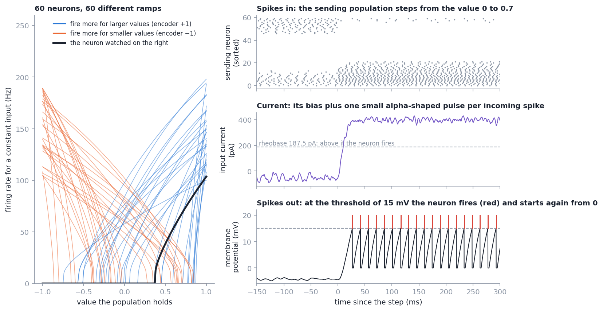
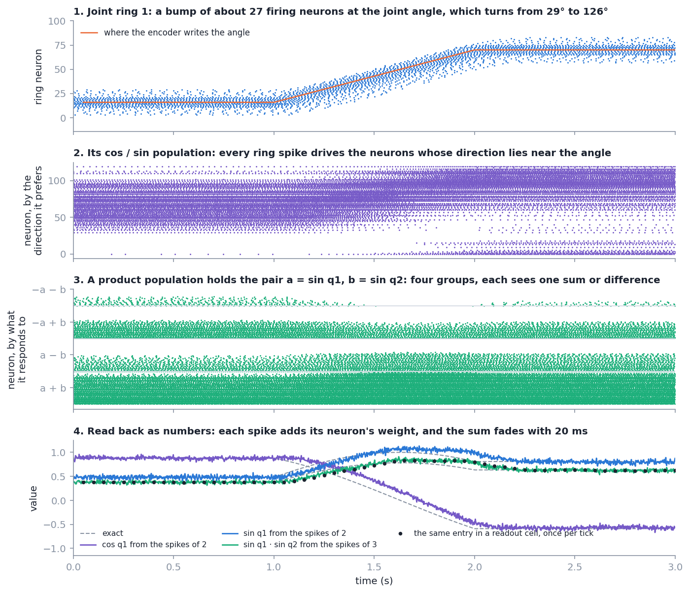
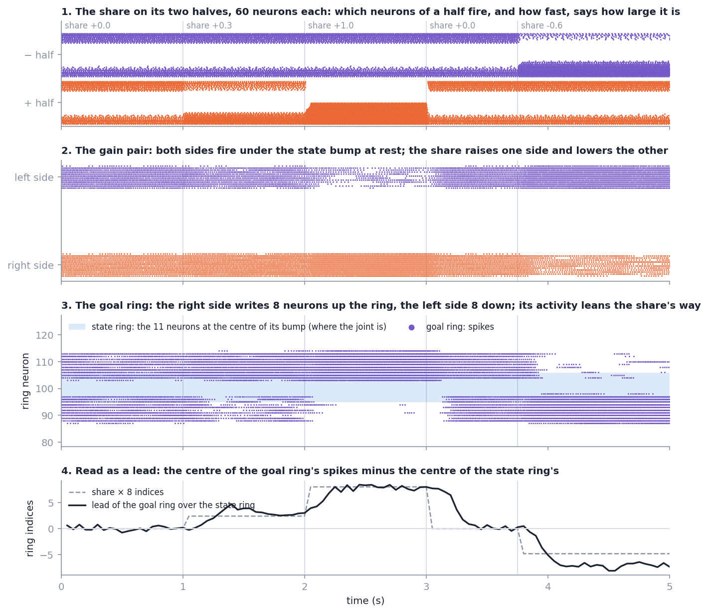

# Technical reference: orientation of the arm from joint rings (SO(3))

The mathematics behind every part of the network, with the derivations. How to run things
is in [`README.md`](README.md); which part is which file is in
[`docs/architecture.md`](docs/architecture.md); what was measured is in
[`docs/results.md`](docs/results.md). The ring attractor itself, its neuron and its
encoder are derived in the technical reference of the SO-2 repo
(`Ring-Attractor-SO-2-Joint-Architecture/TECHNICAL.md`, sections 2 to 6); this page starts
where a joint angle is already a bump on a ring.

Two kinds of statement are kept apart: **Built** (what the code does, with its file) and
**Model** (a few equations that explain why it behaves so).

The page has four pieces. Part I is the forward network (orientation from joint angles).
Part II is the inverse kinematics built on it. Part III goes through both again and says how
each piece of mathematics runs as spikes: which neurons fire, what makes them fire, and how
many spikes carry a number. Appendix A has the standard methods the network is compared
with: their mathematics, the code that runs them here, and the numbers.

## Contents

1. [The task](#1-the-task)
2. [The orientation is a sum of products](#2-the-orientation-is-a-sum-of-products)
3. [Joint by joint](#3-joint-by-joint)
4. [Lift, pitch and yaw](#4-lift-pitch-and-yaw)
5. [A population that holds a value](#5-a-population-that-holds-a-value)
6. [Reading a value back: least-squares readouts](#6-reading-a-value-back-least-squares-readouts)
7. [Connecting two populations](#7-connecting-two-populations)
8. [A population that multiplies](#8-a-population-that-multiplies)
9. [From a bump to cos and sin](#9-from-a-bump-to-cos-and-sin)
10. [Writing an angle between two ring indices](#10-writing-an-angle-between-two-ring-indices)
11. [Readout cells](#11-readout-cells)
12. [The output rings](#12-the-output-rings)
13. [Measuring the error](#13-measuring-the-error)
14. [How the error grows along the arm](#14-how-the-error-grows-along-the-arm)
15. [A moving arm: delay and writing ahead](#15-a-moving-arm-delay-and-writing-ahead)
16. [Symbols](#16-symbols)

Part II, inverse kinematics for orientation (built in `ring_so3/ik/` and `ring_so3/nest/ik_*.py`,
`goal_ring.py`; measured in [`docs/ik/results.md`](docs/ik/results.md)):

17. [The inverse task](#17-the-inverse-task)
18. [Comparing two orientations: the turn that is still to make](#18-comparing-two-orientations-the-turn-that-is-still-to-make)
19. [The cascade: each joint takes its share](#19-the-cascade-each-joint-takes-its-share)
20. [The cascade as populations](#20-the-cascade-as-populations)
21. [One joint's goal ring](#21-one-joints-goal-ring)
22. [Closing the loop: gain, delay, dead zone](#22-closing-the-loop-gain-delay-dead-zone)
23. [A goal that travels](#23-a-goal-that-travels)
24. [From orientation to pose](#24-from-orientation-to-pose)
25. [Symbols of part II](#25-symbols-of-part-ii)
26. [The loop with a robot: light robot and Gazebo](#26-the-loop-with-a-robot-light-robot-and-gazebo)

Part III, in spikes: how each part of the mathematics above runs as spikes in the network
(measured by `scripts/spike_census.py`):

27. [Three steps that every value takes](#27-three-steps-that-every-value-takes)
28. [Who fires, and how often](#28-who-fires-and-how-often)
29. [The forward network, spike by spike](#29-the-forward-network-spike-by-spike)
30. [The inverse-kinematics layer, spike by spike](#30-the-inverse-kinematics-layer-spike-by-spike)
31. [From the mathematics to the spikes: one table](#31-from-the-mathematics-to-the-spikes-one-table)
32. [Where these numbers come from](#32-where-these-numbers-come-from)

Appendix A, the other methods (standard forward kinematics, three standard inverse
kinematics, a solver, path integration): their mathematics, the code that runs them here,
and the comparison with the ring network:

- [A.1 What is compared with what](#a1-what-is-compared-with-what)
- [A.2 Forward kinematics, the standard way](#a2-forward-kinematics-the-standard-way)
- [A.3 The Jacobian of the orientation](#a3-the-jacobian-of-the-orientation)
- [A.4 Jacobian transpose](#a4-jacobian-transpose)
- [A.5 Damped least squares](#a5-damped-least-squares)
- [A.6 Cyclic coordinate descent](#a6-cyclic-coordinate-descent)
- [A.7 The cascade, seen from the standard methods](#a7-the-cascade-seen-from-the-standard-methods)
- [A.8 Solving for the joint angles in one go](#a8-solving-for-the-joint-angles-in-one-go)
- [A.9 The loop in which they are compared](#a9-the-loop-in-which-they-are-compared)
- [A.10 Path integration on SO(3)](#a10-path-integration-on-so3)
- [A.11 The numbers](#a11-the-numbers)
- [A.12 What the comparison says](#a12-what-the-comparison-says)

## 1. The task

A chain of $n$ revolute joints with angles $q_1, \dots, q_n$. Joint $k$ turns about one
coordinate axis of its own frame; its frame sits in the previous link with a fixed rotation
$A_k$. The orientation of link $k$ in the base frame is

```math
R_k = R_{k-1}\, A_k\, \operatorname{Rot}(\text{axis}_k, q_k), \qquad R_0 = I, \qquad
R_{ee} = R_n\, A_{\text{tool}} .
```

$R_{ee} \in SO(3)$: a $3\times3$ matrix with $R^\top R = I$ and $\det R = 1$. The network gets
the $q_k$ as bumps on $n$ rings and has to give $R_k$ for every link.

The elementary rotations, with $c = \cos q$, $s = \sin q$:

```math
\operatorname{Rot}(x,q)=\begin{pmatrix}1&0&0\\0&c&-s\\0&s&c\end{pmatrix},\quad
\operatorname{Rot}(y,q)=\begin{pmatrix}c&0&s\\0&1&0\\-s&0&c\end{pmatrix},\quad
\operatorname{Rot}(z,q)=\begin{pmatrix}c&-s&0\\s&c&0\\0&0&1\end{pmatrix}.
```

## 2. The orientation is a sum of products

**Each entry is linear in each joint's $(1, \cos q_k, \sin q_k)$.** Every entry of
$\operatorname{Rot}(\text{axis}, q)$ is one of $0, \pm1, \pm\cos q, \pm\sin q$, so it is a linear
combination of the three *features* $\varphi_k = (1, \cos q_k, \sin q_k)$. A matrix product
multiplies entries of different factors, never two entries of the same factor. So every
entry of $R_{ee}$ is a sum of terms that take **one** feature from **each** joint:

```math
(R_{ee})_{ij} = \sum_{m_1, \dots, m_n \in \{0,1,2\}} T_{ij,\, m_1 \dots m_n}\; \varphi_{1,m_1}\,\varphi_{2,m_2} \cdots \varphi_{n,m_n} ,
\qquad\text{in short}\qquad \operatorname{vec}(R_{ee}) = T\,\Phi,
```

with $\Phi = \varphi_1 \otimes \cdots \otimes \varphi_n$ the vector of all $3^n$ products and
$T$ a fixed $9 \times 3^n$ matrix that depends only on the axes and the $A_k$. This is the
readout of the paper (Section 2.5, Appendix E). `ring_so3/kinematics.py` builds $T$ and
$\Phi$; `tests/test_kinematics.py` confirms $T\Phi = R$ to $10^{-9}$.

**Example, two joints,** $R = \operatorname{Rot}(x, q_1)\operatorname{Rot}(y, q_2)$:

```math
R = \begin{pmatrix}
c_2 & 0 & s_2\\
s_1 s_2 & c_1 & -s_1 c_2\\
-c_1 s_2 & s_1 & c_1 c_2
\end{pmatrix}
```

Eight different products occur ($c_2$, $s_2$, $c_1$, $s_1$, $s_1 s_2$, $s_1 c_2$, $c_1 s_2$,
$c_1 c_2$) of the $3^2 - 1 = 8$ possible; four of them are products of two factors.

**Most products never occur.** For 2 to 7 joints of the chains here, 8, 13, 21, 34, 55, 89
of the $3^n - 1$ products have a non-zero column in $T$ (for 7 joints: 89 of 2,186). The
reason is the pattern of zeros in the elementary rotations: a joint leaves one row and one
column alone.

**The cost of doing it all at once.** A neural population multiplies two numbers at a time
(section 8). A product of $m$ features needs $m - 1$ pairwise products; sharing common
prefixes, the 89 products of 7 joints need 166 pairwise products.

## 3. Joint by joint

**One joint changes two columns.** Write $M = R_{k-1} A_k$ (known before joint $k$), with
columns $M_x, M_y, M_z$. Multiplying by $\operatorname{Rot}(\text{axis}, q)$ on the right mixes
the two columns that are *not* the axis and leaves the axis column alone. For the axis $z$:

```math
R_k = M \operatorname{Rot}(z, q) = \big(\; M_x c + M_y s,\;\; -M_x s + M_y c,\;\; M_z \;\big),
```

and in general, with $u, v$ the two other axes in cyclic order,

```math
\text{col}_u' = \text{col}_u \cos q + \text{col}_v \sin q, \qquad
\text{col}_v' = -\text{col}_u \sin q + \text{col}_v \cos q, \qquad
\text{col}_{\text{axis}}' = \text{col}_{\text{axis}} .
```

**Cost.** Each of the three rows needs four products (two entries times $\cos$ and $\sin$):
12 per joint. The fixed rotation $A_k$ only re-labels and re-signs columns and needs no
neurons. Products with a constant factor are no products, so the first joints are cheaper:
4, 14, 26, 38, 50, 62 pairwise products for 2 to 7 joints, 12 more for each further joint.

**It is the same sum.** Expanding the recursion gives exactly the terms of $T\Phi$: the
joint-by-joint order evaluates the paper's readout in the order in which the cost grows by a
fixed amount per joint. It also gives $R_k$ of every link on the way, which the all-at-once
form does not.

**The joint's axis in the base frame** is the column that is left alone:
$a_k = (R_k)_{\cdot,\text{axis}}$. The inverse-kinematics ideas and the velocity of the SE-3
repo use this.

`ring_so3/wiring.py` writes the recursion as a list of steps: `Product` (a weighted sum of
earlier values times one $\cos q_k$ or $\sin q_k$) and `Entry` (a matrix entry that is a sum
of two products). Constants are folded.

## 4. Lift, pitch and yaw

**Built** (`kinematics.lift_pitch_yaw`). The three angles are defined by

```math
R = \operatorname{Rot}(z, \psi)\,\operatorname{Rot}(y, \vartheta)\,\operatorname{Rot}(x, \phi),
\qquad \psi = \text{yaw},\; \vartheta = \text{pitch},\; \phi = \text{lift}.
```

Multiplying out,

```math
R = \begin{pmatrix}
c_\psi c_\vartheta & \cdot & \cdot\\
s_\psi c_\vartheta & \cdot & \cdot\\
-s_\vartheta & c_\vartheta s_\phi & c_\vartheta c_\phi
\end{pmatrix}
\quad\Longrightarrow\quad
\vartheta = -\arcsin r_{31},\qquad
\psi = \operatorname{atan2}(r_{21}, r_{11}),\qquad
\phi = \operatorname{atan2}(r_{32}, r_{33}).
```

- The pair $(r_{11}, r_{21}) = c_\vartheta\,(\cos\psi, \sin\psi)$ points in the direction of
  the yaw and has the length $\cos\vartheta$. Likewise $(r_{33}, r_{32})$ for the lift.
- At $\vartheta = \pm 90°$ both pairs have length 0: lift and yaw have no value there (only
  their sum or difference is defined). No readout can change that.
- The paper's Eq. 26 is this extraction. Its Eq. 25 writes the product in the opposite
  order, which does not agree with Eq. 26; the code follows Eq. 26.

## 5. A population that holds a value

Values between the rings (a cosine, a matrix entry, a product) are held by populations of
`iaf_psc_alpha` neurons with ordinary parameters ($C_m = 250$ pF, $\tau_m = 20$ ms,
$V_{th} = 15$ mV, $t_{\text{ref}} = 2$ ms, $\tau_{\text{syn}} = 5$ ms; rheobase
$I_{th} = C_m V_{th}/\tau_m = 187.5$ pA).

**Built** (`ring_so3/neurons.py`). A population of $n$ neurons holds a value $x$ (a number
or a pair) in its firing rates. Neuron $i$ receives the current

```math
J_i(x) = \alpha_i\,\frac{e_i \cdot x}{\rho} + \beta_i ,
```

with $e_i$ its *encoder* (the direction of $x$ it responds to), $\rho$ the radius of the
range, and gain $\alpha_i$ and bias $\beta_i$ chosen so that

- the neuron starts to fire at its own *intercept* $x^0_i$: $J_i = I_{th}$ when $e_i\cdot x/\rho = x^0_i$,
- and reaches its own *maximum rate* $f^{\max}_i$ at the edge of the range, $e_i \cdot x / \rho = 1$.

With $J^{\max}_i$ the current that gives $f^{\max}_i$ (below), these two conditions give

```math
\alpha_i = \frac{J^{\max}_i - I_{th}}{1 - x^0_i}, \qquad \beta_i = I_{th} - \alpha_i\, x^0_i .
```

Intercepts are drawn uniformly from $[-0.9, 0.9]$ and maximum rates from $[100, 200]$ Hz,
from a seed.

**Rate for a constant current** (SO-2 reference, section 2, now with a refractory time):

```math
f(J) = \left[\, t_{\text{ref}} + \tau_m \ln\frac{J}{J - I_{th}} \,\right]^{-1} \quad (J > I_{th}), \qquad f = 0 \text{ otherwise},
```

and inversely $J(f) = I_{th}\,/\,\big(1 - e^{-(1/f - t_{\text{ref}})/\tau_m}\big)$. Each neuron is a
ramp that starts at its intercept; the population is many such ramps with different starts,
slopes and directions.

Three kinds are used:

| Kind | Holds | Encoders | Neurons |
| --- | --- | --- | ---: |
| scalar | one number in $[-1, 1]$ | $+1$ or $-1$ (two halves, "push-pull") | 60 |
| pair | $(\cos, \sin)$ or another pair | all round the circle | 120 |
| product | a pair $(a, b)$ | the four diagonals $(\pm1, \pm1)/2$ | 200 |

## 6. Reading a value back: least-squares readouts

**Built** (`neurons.solve_decoders`). A function $y(x)$ is read from the rates
$r_i(x)$ as a weighted sum $\hat y = \sum_i d_i\, r_i(x)$. The weights (*decoders*) minimise
the squared error over sample inputs $x^{(1)}, \dots, x^{(S)}$, with a penalty that stands
for noise on the rates. With $A_{si} = r_i(x^{(s)})$ and $Y_s = y(x^{(s)})$:

```math
d = \arg\min_d\; \lVert A d - Y \rVert^2 + S\sigma^2 \lVert d \rVert^2
  = \left(A^\top A + S\sigma^2 I\right)^{-1} A^\top Y, \qquad \sigma = 0.02\,\max A .
```

*Why the penalty has this form.* If every rate carries independent noise of variance
$\sigma^2$, the expected squared error of $\hat y$ gains the term $\sigma^2 \lVert d \rVert^2$
per sample; summing over $S$ samples gives $S\sigma^2\lVert d\rVert^2$. The fit then does
not rely on differences of rates that are smaller than the noise.

*Why a sum of ramps can give a function.* Each neuron contributes a ramp
$\max(0, \cdot)$-like curve along its encoder; a weighted sum of ramps with different
starting points is a piecewise-smooth curve that can follow any smooth function of
$e \cdot x$. With encoders in several directions, sums of such functions of different
projections are available. This is the population code of Eliasmith and Anderson, which
the paper cites for its Fourier readout.

**Where the rates come from.** The decoders used in the network are fitted to rates
*measured in NEST* (`ring_so3/nest/calibrate.py`): each kind of population is driven by
spikes of other populations on a grid of values and its spikes are counted for 1 s. The
closed-form $f(J)$ above is used only for the copy without spikes
(`ring_so3/rate/network.py`). No pose of any chain enters a fit.

## 7. Connecting two populations

To hand the value $\hat y = \sum_j d_j r_j$ decoded from population A to population B as
(one coordinate of) B's value, neuron $i$ of B must receive the current
$\alpha_i (e_i \cdot t)\,\hat y / \rho$, where $t$ says into which coordinate of B the value
goes. A spike through a synapse of weight $w$ carries the charge $w\,e\,\tau_{\text{syn}}$
(SO-2 reference, section 2), so the mean current from neuron $j$ is $w_{ij}\, r_j\, e\,\tau_{\text{syn}}$.
Equating,

```math
w_{ij} = \frac{\alpha_i\,(e_i \cdot t)}{\rho}\cdot \frac{d_j}{e\,\tau_{\text{syn}}} .
```

The weight matrix is the outer product of B's input weights and A's decoders: every
connection between two populations has rank one per transmitted value. Several inputs into
one population simply add (currents add), which is how a sum is computed: an `Entry`
population receives two products and holds their sum.

## 8. A population that multiplies

**The identity.** $ab = \tfrac14\left[(a+b)^2 - (a-b)^2\right]$. A product of two numbers is
a difference of two functions of *one* number each: of $a + b$ and of $a - b$.

**Built.** The product population holds the pair $(a, b)$ with encoders on the four
diagonals $(\pm1, \pm1)/2$. Neuron $i$ therefore responds to $e_i \cdot (a,b) = \pm(a+b)/2$
or $\pm(a-b)/2$: it sees only one of the two sums. By section 6 a weighted sum of neurons
that all see $a + b$ can give $(a+b)^2$, and likewise for $a - b$; one set of decoders gives
the difference, the product. The decoders are fitted to $y = ab$ on a $25\times25$ grid of
measured rates.

*Why diagonal encoders and not encoders all round the circle.* A neuron with a general
encoder $(\cos\gamma, \sin\gamma)$ sees $a\cos\gamma + b\sin\gamma$. Only the diagonal
directions are needed for the identity; putting all neurons there spends none on
directions that do not help.

Measured: a product is right to 0.0077 (root mean square) on inputs it was not fitted on.

## 9. From a bump to cos and sin

**Built** (`nest/network.py`, `nest/calibrate.py`). A pair population reads its joint's ring.
Ring neuron $j$ stands for the joint angle $q_j$; it projects with the weights
$\kappa\cos q_j$ and $\kappa\sin q_j$ onto the two coordinates of the pair (through
section 7's input weights). The pair that arrives is

```math
\kappa \sum_j r_j \begin{pmatrix}\cos q_j\\ \sin q_j\end{pmatrix} .
```

**Model.** For a bump of even shape $b$ at the angle $q$, $r_j = b(q_j - q)$, the same step
as for the population vector (SO-2 reference, section 6) gives

```math
\sum_j b(q_j - q)\begin{pmatrix}\cos q_j\\ \sin q_j\end{pmatrix}
= B_1 \begin{pmatrix}\cos q\\ \sin q\end{pmatrix}, \qquad B_1 = \sum_u b(u)\cos u .
```

The bump's width only changes the length $B_1$, not the direction. $\kappa = 1/B_1$ is
measured once from the ring's own activity profile, so the pair has length 1. For a joint
whose range lies on 70% of the ring (the TIAGo arm), the angle that ring neuron $j$ stands
for is the joint angle of that index, continued linearly beyond the arc.

**The readout normalises.** The decoders of the pair population are fitted on a real ring
whose bump is written at 146 positions, with the target $(\cos q, \sin q)$ of the written
angle. A bump is a little stronger or weaker from tick to tick; fitted this way the readout
gives a pair of length 1 for the bump as it really is. Measured: $\cos$ and $\sin$ within
0.018.

The synapse from the ring to this population is slower than the others (15 ms): a ring
neuron fires only 20 to 60 times a second, and a 5 ms synapse would pass every spike on as
a ripple.

## 10. Writing an angle between two ring indices

**The problem.** An encoder that stimulates the 11 neurons around the *nearest* index holds
the angle to half an index: 0.9° on a ring of 200. Over seven joints that alone costs 0.95°
in the median before any decoding.

**Built** (`nest/ring.py: fractional_bump_rates`). The angle's position on the ring is
$x = \lfloor x \rfloor + f$ with $0 \le f < 1$. The stimulus is a blend of the window around
$\lfloor x \rfloor$ and the window around $\lfloor x \rfloor + 1$:

```math
\text{rate}_i = (1 - f)\,W_{\lfloor x \rfloor}(i) + f\,W_{\lfloor x \rfloor + 1}(i),
```

with $W_c(i) = 200$ Hz for $|i - c| \le 5$ and 0 otherwise. The nine neurons in the middle
get the full rate; the two at the ends get $(1-f)$ and $f$ of it. The centre of the stimulus
is $\lfloor x\rfloor(1-f) + (\lfloor x\rfloor+1) f = x$: the angle itself. Measured: the ring
then holds a seven-joint pose to 0.29° instead of 0.96°.

## 11. Readout cells

**Built** (`nest/populations.py`). A readout cell is a neuron whose threshold is out of
reach. Its membrane potential obeys

```math
\tau_r \frac{dV}{dt} = -V + \frac{\tau_r}{C}\,I_{\text{syn}}(t), \qquad \tau_r = 50\ \text{ms},
```

a low-pass filter of its input. With synaptic weights $w_j = d_j\, G /(e\,\tau_{\text{syn}})$,
where $G$ is the current that holds the potential at one unit of value, the potential
settles at $V = \sum_j d_j r_j$ in those units: the decoded value, smoothed with 50 ms.
Nine cells per link and nine for the end effector hold the matrix entries.

The matrix read this way is *raw*: close to a rotation, not exactly one.

## 12. The output rings

**Built** (`nest/network.py`). Each output ring has 100 neurons with preferred angles
$\theta_j = 2\pi j / 100$. Neuron $j$ is driven by a pair $(x, y)$ of decoded values:

```math
J_j = I_{th} + g\,\big(x\cos\theta_j + y\sin\theta_j - h\big), \qquad h = 0.25 .
```

**Why this puts a bump at the right angle.** Write the pair as
$(x, y) = \ell\,(\cos\omega, \sin\omega)$. Then

```math
x\cos\theta_j + y\sin\theta_j = \ell\cos(\theta_j - \omega) :
```

the drive is largest for the neuron whose preferred angle is $\omega$ and falls off as a
cosine. Neurons with $\ell\cos(\theta_j - \omega) > h$ fire: a bump centred on
$\omega = \operatorname{atan2}(y, x)$, of half-width $\arccos(h/\ell)$. The gain $g$ is set
so that the peak neuron fires at 150 Hz for $\ell = 1$. The angle is read as the population
vector of the ring's spikes over four ticks.

The three rings, from section 4:

| Ring | Pair $(x, y)$ | Bump at |
| --- | --- | --- |
| yaw | $(r_{11},\ r_{21})$ | $\operatorname{atan2}(r_{21}, r_{11}) = \psi$ |
| lift | $(r_{33},\ r_{32})$ | $\operatorname{atan2}(r_{32}, r_{33}) = \phi$ |
| pitch | $(\cos\vartheta,\ -r_{31})$ | $\operatorname{atan2}(-r_{31}, \cos\vartheta) = \vartheta$ |

**The pitch ring needs $\cos\vartheta$,** which is not an entry of the matrix. It is the
length of the pair $(r_{11}, r_{21})$ (section 4). One more pair population holds that pair,
and its decoders are fitted to the *length* of what it holds, $\sqrt{x^2 + y^2}$, a function
of the pair that a population with encoders all round the circle can give. The first
version used $\sqrt{1 - r_{31}^2}$ read from a scalar population; that function is steep
near $r_{31} = \pm1$ and gave the pitch ring the largest error of the three.

**Silence near the singular pose.** For lift and yaw $\ell = \cos\vartheta$. When
$\cos\vartheta < h = 0.25$ no neuron is above threshold and the ring is silent: the
network's way of saying that the angle has no value. As $\ell$ falls toward $h$ the bump
narrows and carries fewer spikes, so the angle is read less surely before it disappears.

## 13. Measuring the error

**Orientation error.** For a decoded rotation $\hat R$ and the true $R$, the rotation that
takes one into the other is $\hat R R^\top$, and its angle is

```math
\Delta = \arccos\frac{\operatorname{tr}(\hat R R^\top) - 1}{2} .
```

(For a rotation by $\Delta$ about any axis the trace is $1 + 2\cos\Delta$.) One number, the
same whatever the axis, and with no singular pose.

**Nearest rotation.** The raw matrix $M$ is not exactly a rotation. The rotation closest to
it in the least-squares sense comes from its singular value decomposition $M = U\Sigma V^\top$:

```math
\hat R = U \operatorname{diag}(1, 1, \det(UV^\top))\, V^\top .
```

How far $M$ is from a rotation is reported separately as $\lVert M^\top M - I\rVert$.

**Chance level.** For a rotation drawn uniformly from SO(3), the angle $\Delta$ has the
density $(1 - \cos\Delta)/\pi$ on $[0, \pi]$, so its mean is

```math
\mathbb{E}[\Delta] = \frac{1}{\pi}\int_0^\pi \Delta\,(1 - \cos\Delta)\, d\Delta
= \frac{1}{\pi}\left(\frac{\pi^2}{2} + 2\right) = \frac{\pi}{2} + \frac{2}{\pi} \approx 126.5° .
```

A readout that knows nothing is that far off on average.

**"Similar"** was fixed before the runs as: median $\Delta \le 5°$ and 90th percentile
$\le 10°$ over 300 random held poses.

## 14. How the error grows along the arm

**Model.** Let stage $k$ add an independent small error to the two columns it writes.
Because the stages are linear in the orientation so far, an error made at stage $k$ is
carried on by the later joints as a rotation of the same size (rotations preserve lengths).
If each stage adds an error of variance $\varepsilon^2$ in a random direction, the
variances add:

```math
\Delta_n \approx \sqrt{\Delta_1^2 + (n - 1)\,\varepsilon^2}
```

rather than $\Delta_1 + (n-1)\varepsilon$. Measured medians for the links of `generic7`:
0.21°, 0.47°, 0.60°, 0.74°, 0.85°, 0.98°, 1.06°. The formula with $\Delta_1 = 0.21°$ and
$\varepsilon = 0.42°$ gives 0.21°, 0.47°, 0.63°, 0.76°, 0.87°, 0.96°, 1.05°: the errors of the
stages add like independent errors, not like errors that all point the same way.

**What is not corrected.** Nothing pulls the matrix back onto a rotation between stages, so
its length error also accumulates (measured after one stage: up to 4.7%). The orientation
error is taken after the nearest-rotation step, which removes the part of the error that is
not a rotation.

**Losing neurons.** A decoder $d$ is fitted with all neurons present. Removing a random
5% of the neurons removes their terms from $\sum_i d_i r_i$: the value is off by an amount
that does not average to zero, and every later stage inherits it. Measured: 5.25° in the
median for seven joints with 5% of the product neurons off. Nothing in the network re-fits
$d$.

## 15. A moving arm: delay and writing ahead

**Model.** Every stage is a filter: the ring's bump follows a moving angle with a lag
(measured 0.09 s), the pair population reads it through a 15 ms synapse, each product and
entry population adds a few milliseconds, and the readout cells smooth with 50 ms. Together
the readout is the true orientation of a time $\tau$ earlier, with $\tau = 0.16$ to 0.20 s,
the same at every speed. If the end effector turns at the angular speed $\omega$, the error
while moving is

```math
\Delta_{\text{moving}} \approx \omega\,\tau .
```

Measured: compared with the true orientation one delay earlier, the seven-joint readout at
0.5 rad/s per joint is 1.46° off, about what it is at rest; compared with the orientation
at the same instant, 6.85°.

**Writing ahead** (option `--lead`, `ring_so3/session.py`). A constant delay can be taken
out at the input. To first order $q_k(t + \tau_k) \approx q_k(t) + \tau_k\,\dot q_k(t)$, so
the encoder of joint $k$ is given

```math
\tilde q_k = \operatorname{clip}\big(q_k + \tau_k\, \dot q_k\big), \qquad
\tau_k = 0.14\ \text{s} + 0.01\ \text{s}\cdot(n - k),
```

never beyond a joint limit. An early joint passes through more stages and gets a longer
lead. The network then computes the orientation the arm will have when the result comes
out. Measured: delay 0.03 s, error while moving 1.80° instead of 6.85°. What remains are the
moments at which a joint starts or stops, where $\dot q$ jumps and the first-order
prediction is wrong for one delay.

## 16. Symbols

| Symbol | Meaning |
| --- | --- |
| $q_k$, $\dot q_k$ | angle and velocity of joint $k$ |
| $A_k$ | fixed rotation of joint $k$'s frame in link $k-1$ |
| $R_k$, $R_{ee}$ | orientation of link $k$, of the end effector |
| $\varphi_k = (1, \cos q_k, \sin q_k)$, $\Phi$, $T$ | features of a joint, all their products, the fixed readout matrix |
| $\phi, \vartheta, \psi$ | lift, pitch, yaw: $R = \operatorname{Rot}(z,\psi)\operatorname{Rot}(y,\vartheta)\operatorname{Rot}(x,\phi)$ |
| $e_i$, $\alpha_i$, $\beta_i$, $x^0_i$, $f^{\max}_i$ | encoder, gain, bias, intercept, maximum rate of a neuron |
| $I_{th}$ | rheobase, 187.5 pA |
| $d$ | decoders (readout weights) of a population |
| $\sigma$ | assumed rate noise in the fit, 0.02 of the largest rate |
| $B_1$, $\kappa$ | first Fourier coefficient of the bump shape, its inverse |
| $h$, $g$ | threshold and gain of an output ring neuron |
| $\Delta$ | orientation error, the angle of $\hat R R^\top$ |
| $\tau$, $\tau_k$ | delay of the readout, lead of joint $k$ |

---

# Part II. Inverse kinematics for orientation

## 17. The inverse task

Given: a goal orientation as three angles, lift $\phi^*$, pitch $\vartheta^*$, yaw $\psi^*$, each a
bump on a goal ring. Wanted: joint angles that give the hand this orientation, and a way to
get there. Nothing is inverted. The network computes, all the time, *which way and how far
the hand still has to turn*, hands every joint a share of that turn, and the joints move.
The sequence of small steps is the trajectory.

```
goal rings (3) ─┐
                ├─► comparison e ─► joint 1 takes t1 ─► rest e2 ─► joint 2 takes t2 ─► rest e3 ─► ...
decoded R ──────┘                    │                             │
                                     ▼                             ▼
                              goal ring of joint 1          goal ring of joint 2      (each joint follows its goal ring)
```

**Built:** `ring_so3/ik/rules.py` (the exact rule), `ring_so3/ik/wiring.py` (the same as
products and sums), `ring_so3/nest/ik_network.py` (as populations on top of the forward
network), `ring_so3/nest/goal_ring.py` (a joint's goal ring), `ring_so3/ik/session.py` (the
closed loop).

## 18. Comparing two orientations: the turn that is still to make

Let $R$ be the orientation of the hand (decoded by the forward network) and $G$ the goal.
There is one rotation that takes $R$ to $G$: $G R^\top = \operatorname{Rot}(n, \Delta)$,
about a unit axis $n$ (in the base frame) by an angle $\Delta \in [0, \pi]$.

**Comparison "matrix".** With $r_i$, $g_i$ the columns of $R$ and $G$:

```math
e \;=\; \tfrac12 \sum_{i=1}^{3} r_i \times g_i \;=\; \sin\Delta \; n .
```

*Derivation.* For any vector $v$ and matrix $M$ with columns $m_i$ and $R$ with columns $r_i$,
$\sum_i r_i \times m_i$ is the vector of the antisymmetric part of $M R^\top$:
$\big[\sum_i r_i \times m_i\big]_\times = M R^\top - R M^\top$. Put $M = G$:
$G R^\top - R G^\top = \operatorname{Rot}(n,\Delta) - \operatorname{Rot}(n,\Delta)^\top = 2 \sin\Delta\, [n]_\times$
(Rodrigues: $\operatorname{Rot}(n,\Delta) = I + \sin\Delta [n]_\times + (1-\cos\Delta)[n]_\times^2$, and only
the middle term is antisymmetric). Hence $\sum_i r_i \times g_i = 2 \sin\Delta\, n$. ∎

So $e$ points along the axis about which the hand has to turn, and its length is
$\sin\Delta$: about the angle itself for a small turn, never more than 1, and zero at
$\Delta = 180°$ (section 23 says how that case is avoided). Every component of $e$ is a
sum of six products of one entry of $R$ and one entry of $G$: 18 products.

$G$ is not given, the three goal angles are. $G = \operatorname{Rot}(z,\psi^*)\operatorname{Rot}(y,\vartheta^*)\operatorname{Rot}(x,\phi^*)$
is the orientation of a three-joint chain with axes z, y, x, so the forward network's own
wiring builds it from the cos and sin of the three goal rings (section 3): 14 products.
Together 32.

**Comparison "angles".** The other way through cos and sin: compare lift with lift, pitch
with pitch, yaw with yaw. With $N = |(r_{11}, r_{21})| = \cos\vartheta$ (the forward network
has it, section 12):

```math
\begin{aligned}
d_\phi &= \sin\phi^*\, r_{33} - \cos\phi^*\, r_{32} &&= \cos\vartheta\,\sin(\phi^* - \phi),\\
d_\vartheta &= \sin\vartheta^*\, N + \cos\vartheta^*\, r_{31} &&= \sin(\vartheta^* - \vartheta),\\
d_\psi &= \sin\psi^*\, r_{11} - \cos\psi^*\, r_{21} &&= \cos\vartheta\,\sin(\psi^* - \psi),
\end{aligned}
```

using $r_{33} = \cos\vartheta\cos\phi$, $r_{32} = \cos\vartheta\sin\phi$, $r_{31} = -\sin\vartheta$,
$r_{11} = \cos\vartheta\cos\psi$, $r_{21} = \cos\vartheta\sin\psi$. Six products. A change of
lift turns the hand about its own x axis $r_1$, a change of pitch about the horizontal axis
$\hat y' = (-\sin\psi, \cos\psi, 0)$, a change of yaw about $\hat z$. So the three differences become
a turn vector as

```math
e \;=\; d_\phi\, r_1 \;+\; d_\vartheta\,(-r_{21},\, r_{11},\, 0) \;+\; d_\psi\, \hat z ,
```

five more products (11 in all). Since $(-r_{21}, r_{11}, 0) = \cos\vartheta\,\hat y'$, this is
$\cos\vartheta$ times the turn vector of the three small angle differences. It agrees with the
matrix comparison for small differences at level pitch; it shrinks toward pitch ±90°, where
lift and yaw lose their meaning, and for large differences it is not the shortest turn.

**Built:** `rules.turn_from_matrices`, `rules.turn_from_angles`; in spikes the comparison is held
by three populations as $2e$, so that a turn of 0.5 rad fills their range; larger turns
are held at 0.5 rad per component (measured: this bound costs nothing, `docs/ik/results.md`).

## 19. The cascade: each joint takes its share

Joint $k$ turns link $k$ and everything after it about its axis $a_k$, a unit vector in the
base frame. $a_k$ is the column of link $k$'s orientation that belongs to the joint's axis
(a joint leaves that column unchanged), so the forward network already holds it; for the
first joint it is a constant. If the joints move by small $\delta q_k$, the hand turns by

```math
\delta\omega \;=\; \sum_{k=1}^{n} a_k\, \delta q_k .
```

The cascade hands the turn down the arm:

```math
e_1 = e, \qquad t_k = \operatorname{clip}\big(a_k \cdot e_k,\; \pm c_k\big), \qquad e_{k+1} = e_k - a_k\, t_k .
```

$t_k$ is joint $k$'s **share**: the part of what is left that lies about its own axis, at most
$c_k$ (the largest step the joint takes, section 21). $e_{k+1}$ is what is left for the
joints after it.

**The shares add up to the turn.** Summing the last equation over $k$ (it telescopes):

```math
\sum_{k=1}^{n} a_k\, t_k \;=\; e - e_{n+1} .
```

If the joints move in proportion to their shares, $\delta q_k = \kappa\, t_k\, \delta t$, the hand
turns by $\kappa\,\delta t\,(e - e_{n+1})$: exactly along the turn that was asked for, less what
no joint could take. Without caps, $e_{k+1} = (I - a_k a_k^\top)\, e_k$ is $e_k$ with its part
along $a_k$ removed, so $|e_{k+1}| \le |e_k|$, and after three joints whose axes are
perpendicular nothing is left. When nothing is left, $\dot\Delta = -\kappa \sin\Delta$ and the
hand turns about the fixed axis $n$: the shortest path.

**Why not give every joint the whole comparison?** Then $t_k = a_k \cdot e$ and the hand turns
by $\kappa\,\delta t\, \big(\sum_k a_k a_k^\top\big) e$. The matrix $\sum_k a_k a_k^\top$ has trace $n$:
with seven joints the turn is made up to seven times over along some directions and less
along others. The gain has to be lowered for the direction that is served most, and the
path bends toward it. This is the transpose-of-the-Jacobian rule; the cascade is the same
rule with the parts that were already handed out taken away (a Gauss-Seidel sweep instead
of a gradient step).

**A joint that cannot take its share passes it on.** At its cap it takes $c_k$ and the excess
stays in $e_{k+1}$. Near a joint limit, the share that points beyond the limit is reduced:
with $\rho \in [0, 1]$ falling from 1 to 0 over the last 5 ring indices before the limit,

```math
|t_k| \;\leftarrow\; \max\big(|t_k| - (1 - \rho)\, c_k,\; 0\big),
```

which is what inhibition from the joint's own ring does to the population that holds that
half of the share (section 20). At the limit nothing is taken and all of it is passed on.

**Built:** `rules.cascade`, `rules.faded`, `rules.limit_room`; tested against the identity above
in `tests/test_ik_rules.py`.

## 20. The cascade as populations

Everything above is sums and products of values the network holds, so it is built from the
two parts of sections 5 to 8. `ring_so3/ik/wiring.py` lists the steps; the network and the
exact evaluation follow the same list (`tests/test_ik_wiring.py` checks them against
`rules.cascade` to $10^{-9}$).

| Value | Held by | Fed with |
| --- | --- | --- |
| cos, sin of a goal angle | a cos / sin population per goal ring (section 9) | the goal ring |
| goal matrix $G$ | 14 products, 4 sums | goal cos / sin (the wiring of a z, y, x chain) |
| $2e$ | 3 sum populations | 18 products $r_{ai}\,g_{bi}$ (or the 11 of the angle comparison) |
| $a_k \cdot e_k$ | 3 products per joint (none for joint 1, whose axis is constant; 2 for joint 2, whose axis has a zero) | link entries, rest |
| share of joint $k$ | two **half** populations: $h_k^+ = [x]_0^1$, $h_k^- = [-x]_0^1$ with $x = a_k\cdot e_k / c_k$ | the products |
| $2e_{k+1}$ | 3 sum populations | $2e_k - 2c_k\, a_k (h_k^+ - h_k^-)$: 3 more products (none for joint 1, 2 for joint 2) |

- The share is $t_k = c_k (h_k^+ - h_k^-)$. Two halves and not one signed value, because each
  half drives one side of the joint's gain pair (section 21) and each is held down
  separately near its joint limit: ring neurons within 5 indices of the upper limit inhibit
  $h_k^+$ with a weight that rises linearly toward the limit, those near the lower limit $h_k^-$.
- A half is the forward network's scalar population with another readout: least squares to
  $[x]_0^1$ instead of to $x$, fitted on inputs from $-2.2$ to $2.2$, with the small values
  sampled twice as densely (`ring_so3/nest/ik_calibrate.py`). The sums that carry $2e$ use a
  readout fitted on the same wide range that stays at $\pm1$ outside it.
- From the third joint on a joint costs 6 products, 3 sums and 2 halves: 1,500 neurons. The
  first costs 3 sums and 2 halves (300 neurons), the second 4 products more (1,100).
- The rest passes through four populations per joint. The measured error of a share does
  not grow along the arm (`docs/ik/results/tables.md`, section 2).

## 21. One joint's goal ring

Each joint has, beside its state ring $S_k$ (where the joint is), a goal ring $G_k$ (where it
should be next). The share has to push the bump of $G_k$ ahead of the bump of $S_k$; the
joint then follows $G_k$. Wanted: a **lead** $\ell_k$ (ring indices) that is zero without a
share, has the share's sign down to shares of 0.02 rad, and grows with it up to a cap.

**Built (the version that is used): a ring that is written, not an attractor.** One gain pair,
as in the SO-2 model, but gated by the *state* bump:

- gain neuron $i$ of the left and of the right side gets the spikes of state neuron $i$
  (weight 137,000: under the 68 Hz of the bump's centre this is 0.9 of the current at
  which a gain neuron starts to fire) and a constant 304,000 pA. So under the state bump
  both sides fire at a resting rate, elsewhere they are silent;
- the share moves the two sides apart (push-pull): the right side gets
  $+D\,(h^+ - h^-)$, the left side $-D\,(h^+ - h^-)$, with $D$ = 228,000 pA;
- right neuron $i$ excites goal neuron $i + m$, left neuron $i$ goal neuron $i - m$, with $m = 8$.

**Model.** The goal ring's activity is the state bump copied $m$ indices up with the weight
of the right side's rate $r_R$ and $m$ indices down with the weight of $r_L$. Its centre is at

```math
\ell \;=\; m\,\frac{r_R - r_L}{r_R + r_L} .
```

Without a share $r_R = r_L$ and $\ell = 0$ by symmetry, whatever the rates are. A full share
silences one side: $\ell = \pm m$, which is the cap. In between the lead follows the share,
and because both sides fire at rest there is no threshold a small share would have to cross.
So $c_k = m\,\rho_k$ with $\rho_k$ the joint's radians per ring index: the largest share is the
largest lead.

**What was tried first, and why it is not used.** The picture of architecture v4: $G_k$ a ring
attractor, a share pair that shifts its bump, a body pair that pulls it back to the state
bump, the lead being where the two balance. (a) with the share pair silent at rest and (b)
in push-pull were scanned over feedback weights and drives (`scripts/run_ik_goal_ring.py`).
None of the settings met the marks. A bump of this attractor moves only when the gain
spikes that push it exceed a threshold, and then it slips by more than an index; pulled
from two sides it sticks, jumps and is lost. A graded lead below one index, which a share
of 0.02 rad needs, does not come out of it. The written ring keeps the gain pair and the
competition of two sides, and gives up the memory of the goal ring: its bump exists only
while the state ring and the pair drive it. Numbers: `docs/ik/results/tables.md`, section 3.

## 22. Closing the loop: gain, delay, dead zone

The light robot moves every joint toward the angle its goal ring holds,
$\dot q_k = \kappa\,(\hat q^{G}_k - q_k)$, so with $\hat q^G_k - q_k \approx t_k$:
$\dot q_k = \kappa\, t_k$, and from section 19, while nothing is left over and the turn is small,

```math
\dot\Delta(t) \;=\; -\kappa\,\Delta(t - \tau) ,
```

where $\tau$ is how late the comparison sees the arm (the forward network's delay, about
0.2 s, section 15, plus the cascade's populations) and how late a share shows as a lead of
the goal ring (0.2 to 0.3 s, section 30.7).

- **Model.** This delay equation is stable for $\kappa\tau < \pi/2$ and approaches zero without
  overshoot for $\kappa\tau \le 1/e \approx 0.37$. With $\tau$ = 0.2 to 0.3 s the gain should stay
  below about 1.2 to 1.8 per second.
- **Built.** $\kappa$ = 1.25 per second, set on development pairs and then frozen. The lead of
  the written ring is somewhat steeper than the share in the middle of its range (about
  1.4 times), so the effective gain is higher than $\kappa$ there.
- **Large turns are rate-limited, not proportional.** A joint takes at most $c_k$ = 8 indices
  (0.25 rad on a ring that covers the circle), so it moves at most at $\kappa c_k$ ≈ 0.3 rad/s.
- **Dead zone.** If shares below $d$ move nothing, the loop stops while every $|a_k\cdot e_k| < d$;
  the hand then rests up to about $d$ per independent direction from the goal. The exact
  rule tolerates $d$ up to 0.02 rad (final error about 1°); the written ring has no dead
  zone, and what remains is the offset of a share's readout (about 0.01 rad).
- **End of a trial.** In the spiking network the decoded shares never fall silent, so a
  trial ends when the hand has turned less than 0.5° within 2 s (or after 20 s).

## 23. A goal that travels

Two reasons not to write a new goal on the goal rings at once:

- a bump does not jump. A ring attractor that is stimulated far from its bump keeps the old
  bump for seconds (measured: goal rings 10° to 40° off for a whole trial when the goal was
  moved in jumps);
- $e = \sin\Delta\, n$ is zero for a turn of 180° and small near it.

So the three goal angles move toward a new goal at up to 1 rad/s, lift and yaw the short
way round (`rules.travel`). The comparison then never sees the whole turn at once: it sees
the goal a little ahead of the hand.

## 24. From orientation to pose

The cascade does not know that $e$ is a turn. It takes a list of error cells and, per joint,
the direction in which that joint moves them. For orientation the direction is $a_k$. For
the position of the hand it is $a_k \times (p - p_k)$, the lever from the joint to the hand,
which the SE(3) network already builds for its velocity path. A pose goal stacks both:

```math
E = \begin{pmatrix} e \\ \lambda\,(p^* - p) \end{pmatrix}, \qquad
J_k = \begin{pmatrix} a_k \\ \lambda\, a_k \times (p - p_k) \end{pmatrix}, \qquad
t_k = \frac{J_k \cdot E_k}{|J_k|^2}, \qquad E_{k+1} = E_k - J_k\, t_k ,
```

with a weight $\lambda$ (per metre) between turning and moving. The division by $|J_k|^2$ is 1
for orientation alone, which is why it does not appear above. Not built here.

## 25. Symbols of part II

| Symbol | Meaning |
| --- | --- |
| $\phi^*, \vartheta^*, \psi^*$; $G$; $g_i$ | goal lift, pitch, yaw; the goal orientation; its columns |
| $n$, $\Delta$ | axis and angle of the rotation from $R$ to $G$ |
| $e$ | the comparison: $\sin\Delta\, n$, the turn that is still to make |
| $d_\phi, d_\vartheta, d_\psi$ | sine-differences of the angle comparison |
| $a_k$ | turning axis of joint $k$ in the base frame |
| $t_k$, $c_k$ | share of joint $k$, the largest share it takes (8 ring indices) |
| $e_k$ | what is left of the turn before joint $k$; $e_{n+1}$: what no joint took |
| $h_k^+, h_k^-$ | the two halves of a share, each between 0 and 1 |
| $\rho$ | room before a joint limit, 1 away from it, 0 at it |
| $S_k$, $G_k$, $\ell_k$, $m$ | state ring, goal ring, lead of the goal bump, shift of the gain pair's writing |
| $r_L, r_R$ | rates of the two sides of the gain pair |
| $\kappa$, $\tau$ | loop gain (1.25 per second), delay of the comparison |

## 26. The loop with a robot: light robot and Gazebo

Both robots answer the same call (`ring_so3/robots.py`): `follow(targets, time_s, dt)`, "move
toward these joint angles as if to arrive after `time_s`, for one tick".

- **Light robot.** $q \leftarrow q + (q^{target} - q)\,\delta t / T$, inside the joint limits. With
  the target the goal ring's angle and $T = 1/\kappa$ this is $\dot q = \kappa\,(\hat q^G - q)$,
  section 22.
- **Gazebo.** The seven targets go to the TIAGo arm's trajectory controller as one point with
  `time_from_start` $= T$. The controller interpolates from where its own set-point is to the
  target, which is the same proportional approach, and a PID per joint tracks the set-point.
  Then exactly one tick of physics passes: physics is paused, and `RosLink.step` unpauses,
  waits until `/clock` has advanced by 50 ms on an absolute schedule, and pauses again
  (`ring_so3/gazebo/link.py`, after SO-2 `cosim/stepping.py`). Measured: 1.002 s of Gazebo
  time for 20 ticks. So the network may be as slow as it likes; the robot does not run away
  from it.
- **What Gazebo adds to the loop:** the joint is behind its set-point (a first-order lag of
  the PID, a few hundredths of a radian while moving), gravity, and the arm's own body. The
  lag acts like extra delay $\tau$ in section 22.
- **The world** (`gazebo/ring_ik.world`) has the ground, a light and one camera. The base is
  not anchored in the TIAGo model; it is put back at the origin before every trial.

---

# Part III. In spikes

Parts I and II say *what* is computed. This part says how each of those computations exists
in the network as spikes: which neurons fire, what makes them fire, how many spikes carry a
number, and what a spike does where it arrives. Every number here is measured in NEST by
`scripts/spike_census.py` (the census is in [`docs/spikes/census.md`](docs/spikes/census.md),
the numbers behind the figures in `docs/spikes/figures.json`) or follows from a formula that
is given. Section 32 has the commands.

## 27. Three steps that every value takes

A number never travels through the network as a number. From one population to the next it
takes three steps, and they are the same everywhere.

| Step | What happens | Where it is in parts I and II |
| --- | --- | --- |
| 1. Value to current | every receiving neuron gets a current that grows with the value along its own direction | $J_i = \alpha_i\, e_i\cdot x/\rho + \beta_i$, section 5 |
| 2. Current to spikes | the neuron integrates the current; each time its potential reaches the threshold it fires and starts again | the rate $f(J)$, section 5 |
| 3. Spikes to current | every spike adds a short pulse of current to each neuron it is connected to, as large as the synapse's weight | $w_{ij}$, section 7 |

Step 3 of one population *is* step 1 of the next: there is no place where the value $x$ is
stored and multiplied by $\alpha_i e_i$. The current $\alpha_i\, e_i\cdot x/\rho$ arrives as the
sum of thousands of small pulses per second, and the bias $\beta_i$ is a constant current of
the neuron itself.

**Step 2 in full.** The neuron is NEST's `iaf_psc_alpha` (SO-2 reference, section 2):

```math
C_m \frac{dV}{dt} = -\frac{C_m}{\tau_m}\,V + \beta + \sum_{\text{spikes } s \text{ that arrive}} w_s\, \frac{e}{\tau_{\text{syn}}}\,(t - t_s)\, e^{-(t - t_s)/\tau_{\text{syn}}},
\qquad V \ge V_{th} \Rightarrow \text{spike},\; V \leftarrow 0,\; \text{silent for } t_{\text{ref}} .
```

- A current below the *rheobase* $I_{th} = C_m V_{th}/\tau_m$ lifts the potential to
  $J\tau_m/C_m < V_{th}$ and no further: the neuron is silent, however long it waits.
- A current above it makes the potential cross the threshold again and again, the faster the
  larger the current: $f(J) = 1/\big(t_{\text{ref}} + \tau_m \ln\frac{J}{J - I_{th}}\big)$.
- A spike itself has no size. All it carries is *that* it happened, *when*, and *from which
  neuron*. The size is in the weight of each synapse it passes.

**Step 3 in full.** A spike of sender $j$ through a synapse of weight $w_{ij}$ adds to the
current of receiver $i$ a pulse that rises to $w_{ij}$ pA after $\tau_{\text{syn}}$ and decays;
its charge is $w_{ij}\,e\,\tau_{\text{syn}}$. A sender firing at the rate $r_j$ therefore
contributes the mean current $w_{ij}\, r_j\, e\,\tau_{\text{syn}}$. With
$w_{ij} = \alpha_i (e_i\cdot t)\, d_j / (\rho\, e\,\tau_{\text{syn}})$ (section 7) the pulses of all
senders add up to $\alpha_i\,(e_i \cdot t)\,\hat y/\rho$ with $\hat y = \sum_j d_j r_j$: the decoded
value, already multiplied by what receiver $i$ needs. A negative weight is a negative pulse.

**The four kinds of cell.**

| Cell | Where | $C_m$ | $\tau_m$ | $V_{th}$ | Constant current | Rheobase | Synapse | $t_{\text{ref}}$ |
| --- | --- | ---: | ---: | ---: | --- | ---: | --- | ---: |
| population neuron | cos / sin, product, sum, share half, length, output ring | 250 pF | 20 ms | 15 mV | its own bias, between about −8,500 and +680 pA | 187.5 pA | 5 ms (15 ms from a ring) | 2 ms |
| ring neuron | joint rings, goal rings; a joint's goal ring | 3.96·10⁶ pF | 7.04 ms | 0.8 mV | 450,000 pA, exactly its rheobase (none on a joint's goal ring) | 450,000 pA | 27 ms (positive), 50 ms (negative) | 0 |
| gain neuron | the two sides of a gain pair | 3.96·10⁶ pF | 7.04 ms | 1.35 mV | 304,000 pA | 759,375 pA | 27 ms, 50 ms | 0 |
| readout cell | matrix entries, comparison and shares for the tests and the page | 250 pF | 50 ms | out of reach | constants of the entry | – | 5 ms | – |

**One neuron, watched.**



Left: the 60 neurons of a sum population are 60 different ramps. Each starts to fire at its
own value and half of them prefer large values, half small ones. Right: one of them (black
on the left), in NEST, while the population that sends to it steps from the value 0 to 0.7.
This neuron starts to fire at the value 0.37, with $\alpha = 642$ pA and $\beta = -52$ pA.

- **Before the step** 1,840 spikes per second arrive from the 60 senders. Their pulses,
  positive and negative, cancel: the current is $-52$ pA, the bias alone. The potential rests
  at $J\tau_m/C_m = -52 \cdot 20/250 = -4.2$ mV and the neuron is silent.
- **After the step** 2,600 spikes per second arrive and no longer cancel. The current
  settles at 399 pA (the formula of step 1: $642 \cdot 0.7 - 52 = 397$ pA) with a ripple of
  ±14 pA, which is the single pulses showing through.
- **The first spike** comes 27 ms after the step, when the potential has climbed from
  −4.2 mV to 15 mV. From then on the neuron fires every 14.7 ms: 68 Hz, as $f(J)$ says for
  397 pA.

**How large one spike is.** Between two populations a weight is a few pA: the median size is
4 to 7 pA, the largest 140 to 250 pA, about half of them negative (for the two readouts of
the IK layer that hold a bound, up to 880 pA). Against a rheobase of 187.5 pA and working
currents of several hundred pA, one spike decides nothing. A value is carried by the
thousands of spikes per second that arrive at every neuron.

**Zero is not silence.** A population that holds the value 0 fires: about half of its
neurons are above their own starting point at 0. A sum population at 0 sends 93 spikes per
tick from 31 of its 60 neurons. The number is in the *weighted* sum $\sum_j d_j r_j$, in which
positive and negative weights cancel. Only the rings and the gain pairs use silence itself
as a signal (sections 29.1, 30.5).

**Regular, not random.** A neuron under a nearly constant current fires like a clock. The
gaps between the spikes of a population neuron vary by 2% to 7% of their mean (a random,
Poisson-like train: 100%). Three things follow:

- the number of spikes a population sends in a tick scatters far less than a random count
  of the same size would;
- the neurons of a population start from different potentials, so their clocks are out of
  step and the summed current is smooth although every train is regular;
- the only random numbers in the network are those of the encoders' spike generators
  (section 29.1). A run repeats spike for spike with the same seed and number of threads; with
  another number of threads the generators draw other numbers and the results differ slightly.

## 28. Who fires, and how often

The three-joint chain with its IK layer, 16,900 neurons, held at one pose while a turn is
asked of it, for 2 s of network time ([`docs/spikes/census.md`](docs/spikes/census.md), which
also has the same network at its goal and every joint's numbers). "Fire": at least one spike
per second. A tick is 50 ms.

| Kind of population | How many | Neurons in each | Fire | Rate of those that fire | Spikes per tick, each | Gaps vary by |
| --- | ---: | ---: | ---: | ---: | ---: | ---: |
| joint ring | 3 | 200 | 27 | 38 Hz | 51 | 2% |
| cos / sin of a joint | 3 | 120 | 71 | 81 Hz | 287 | 2% |
| product, forward network | 14 | 200 | 110 | 82 Hz | 447 | 2% |
| sum: entry of a link's orientation | 4 | 60 | 30 | 98 Hz | 148 | 3% |
| length of a pair (cos of pitch) | 1 | 120 | 58 | 65 Hz | 187 | 3% |
| output ring | 3 | 100 | 34 | 56 Hz | 106 | 11% |
| goal ring | 3 | 200 | 27 | 38 Hz | 51 | 1% |
| cos / sin of a goal angle | 3 | 120 | 67 | 93 Hz | 312 | 1% |
| product, goal orientation | 14 | 200 | 112 | 84 Hz | 469 | 2% |
| sum, goal orientation | 4 | 60 | 30 | 99 Hz | 151 | 3% |
| product, comparison | 18 | 200 | 112 | 78 Hz | 437 | 2% |
| sum: the comparison $e$ | 3 | 60 | 31 | 87 Hz | 132 | 6% |
| product, cascade | 10 | 200 | 113 | 79 Hz | 446 | 3% |
| share half | 6 | 60 | 31 | 172 Hz | 261 | 5% |
| sum: what is left | 9 | 60 | 32 | 68 Hz | 110 | 7% |
| gain pair, one side | 6 | 200 | 11 | 86 Hz | 50 | 23% |
| goal ring of a joint | 3 | 200 | 16 | 155 Hz | 109 | 9% |

- **All together** 32,539 spikes per tick, 650,784 per second: 38.5 per neuron and second.
- **In a population about half of the neurons fire** whatever value it holds, at 65 to 100 Hz.
  A product population sends about 450 spikes per tick, a sum population 110 to 150.
- **In a ring 27 of 200 fire** and the rest are silent: a place code, with ten times fewer
  spikes per neuron than a population.
- The products carry most of the traffic: 56 product populations send 25,000 of the 32,539
  spikes.

## 29. The forward network, spike by spike



The two-joint chain $R = \operatorname{Rot}(x, q_1)\operatorname{Rot}(y, q_2)$ while joint 1 turns
from 29° to 126° and joint 2 is held at 52°. Rows 1 to 3 are spikes, one dot each. Row 4
turns the spikes of rows 2 and 3 back into numbers: every spike adds its neuron's decoder,
and the sum fades with 20 ms.

### 29.1 A joint angle becomes spikes on its ring

**Mathematics:** the angle $q_k$, to be held as a bump at the ring position $x(q_k)$ (section 10).

**In spikes.** Each of the 200 ring neurons has a spike generator of its own. Every tick the
generators of the 11 neurons around $x(q_k)$ are set to 200 random spikes per second (the two
at the ends to the fractions $1-f$ and $f$ of that), all others to none. A generator spike
arrives with the weight 4,500 pA.

- One such spike carries the charge $4{,}500 \cdot e \cdot 27\ \text{ms} = 330$ pC and lifts the
  potential of its ring neuron by 0.083 mV, a tenth of the way to the threshold of 0.8 mV.
- 200 of them per second are a mean current of 66,054 pA: 0.147 of the ring neuron's
  rheobase. The ring neuron's own constant current is *exactly* its rheobase (450,000 pA),
  which holds it at the threshold without crossing it, so this extra 14.7% decides. With
  $J = I_{th}(1 + \varepsilon)$ the rate is $1/(\tau_m \ln\frac{1+\varepsilon}{\varepsilon})$: for
  $\varepsilon = 0.147$, 69 Hz. Measured: up to 72 Hz.
- The generators are random; the ring neurons are not. Each integrates about three generator
  spikes per spike of its own over a membrane of large capacitance, and the gaps between its
  spikes vary by 2%.

### 29.2 The bump keeps its shape through the ring's own spikes

**Mathematics:** the ring's weights $w(d)$, narrow excitation and wider inhibition (SO-2
reference, section 3).

**In spikes.** Every spike of a ring neuron goes to all 200 ring neurons, with the weight
$w(d)$ of their distance: at most +3.0 pA for a neighbour, down to −1.13 pA at 24 neurons'
distance. One such spike carries 0.22 pC, 1,500 times less than a generator spike. It
matters all the same, because the receiving neuron sits exactly at its threshold: the rate
depends on the *logarithm* of the extra current, and an extra current of 100 pA
($\varepsilon \approx 2\cdot10^{-4}$) already gives $1/(7.04\ \text{ms}\cdot\ln(1/\varepsilon)) \approx 17$ Hz.

Summing the weights over the measured rates of a held bump gives the current that the
ring's own spikes send to a neuron at each distance from the bump's centre:

| Distance from the centre (neurons) | 0 | 5 | 6 | 8 | 10 | 13 | 14 | 20 | 30 |
| --- | ---: | ---: | ---: | ---: | ---: | ---: | ---: | ---: | ---: |
| Current from the ring's own spikes (pA) | +174 | +142 | +130 | +100 | +65 | +9 | −10 | −100 | −116 |
| Rate that current alone gives (Hz) | 18 | 18 | 17 | 17 | 16 | 13 | 0 | 0 | 0 |
| Rate measured (Hz) | 66 | 67 | 17 | 17 | 16 | 13 | 0 | 0 | 0 |

- The 11 stimulated neurons (distance 0 to 5) fire at 66 to 68 Hz: the generators decide.
- The 8 neighbours on each side fire at 13 to 18 Hz without any generator, exactly as fast
  as the ring's own spikes make them.
- From the 14th neuron on the current is negative, and a neuron at threshold with a negative
  current is silent. The bump ends there.
- Together 27 neurons, about 1,020 spikes per second, 51 per tick (row 1 of the figure).

### 29.3 Ring spikes become cos and sin

**Mathematics:** $(\cos q, \sin q) = \kappa \sum_j r_j\,(\cos q_j, \sin q_j)$, section 9.

**In spikes.** Every ring spike goes to all 120 neurons of the joint's cos / sin population.
The weight from ring neuron $j$ to population neuron $i$ is

```math
w_{ij} = \frac{\alpha_i}{\rho}\; e_i \cdot \begin{pmatrix}\cos q_j\\ \sin q_j\end{pmatrix}\; \frac{\kappa}{e\,\tau_{15}}, \qquad \tau_{15} = 15\ \text{ms},
```

positive when neuron $i$'s direction $e_i$ points toward the angle $q_j$ of the ring neuron
that fired, negative when it points away (median size 7 pA, largest 135 pA).

- A ring spike is a vote of size $\kappa = 0.001$ for its neuron's angle. The bump casts
  about 1,020 votes per second; $\kappa$ is set so that they add up to a pair of length 1.
- A pulse of the 15 ms synapse lasts about 40 ms (its area over its peak is $e\,\tau$), so
  about 40 pulses overlap at any moment. With 5 ms it would be 14, and single spikes would
  show through as ripple.
- Which neurons fire: each one for angles in a range around its own direction, 41° to 164°
  to each side depending on its starting point (105° in the median). Row 2 of the figure:
  the band of firing neurons moves as the joint turns. 71 of 120 fire, at 81 Hz in the
  mean, 287 spikes per tick.

### 29.4 A product in spikes

**Mathematics:** $ab = \tfrac14[(a+b)^2 - (a-b)^2]$, section 8.

**In spikes.** The 200 neurons of a product population are four groups of 50. The spikes that
carry $a$ and the spikes that carry $b$ arrive at all of them, with weights of such signs
that a neuron of the first group gets the current $\alpha_i (a+b)/2 + \beta_i$, of the second
$\alpha_i (a-b)/2 + \beta_i$, of the third $\alpha_i(-a+b)/2 + \beta_i$, of the fourth
$\alpha_i(-a-b)/2 + \beta_i$. No neuron sees $a$ or $b$ alone.

- In row 3 of the figure $a = \sin q_1$ grows from 0.48 to 1 and settles at 0.81, $b = \sin q_2 = 0.78$.
  The group that sees $a + b$ fires densely, the group that sees $-a-b$ hardly at all, and
  the two groups for $\pm(a - b)$ in between; as $a$ passes $b$ they swap.
- The product is nowhere in these spikes as a rate. It is the weighted sum $\sum_i d_i r_i$
  with decoders fitted to $ab$. As the identity says, the fitted weights are positive in
  the two groups that see $\pm(a+b)$ and negative in the two that see $\pm(a-b)$ (for three
  neurons in four), and in each group they are largest for the neurons that start to fire
  late, which is how a sum of ramps becomes a square.
- 110 of 200 fire, at 82 Hz, 447 spikes per tick. Read back (row 4, green) the product is
  right to about 0.01 once the joint rests and has a ripple of 0.02.

### 29.5 A sum in spikes, and constants

**Mathematics:** an entry of a link's orientation is a sum of two products (section 3).

**In spikes.** A sum needs no cell of its own that adds. The spikes of both product
populations arrive at the same 60 neurons, each through weights
$\alpha_i e_i\, d_j/(\rho\, e\,\tau_{\text{syn}})$ with the decoders of its own population, and
their pulses add in the membrane. A constant term is a constant current added to the bias.
30 of the 60 neurons fire, 148 spikes per tick.

### 29.6 Numbers out: readout cells and output rings

- **Readout cell** (section 11): a cell that never fires. Spikes arrive with weights
  $d_j \cdot 50\ \text{pA}/(e\,\tau_{\text{syn}})$ (about 1 pA each) and its potential settles
  at 10 mV per unit of value, smoothed with 50 ms. It is how the tests and the page read a
  matrix entry (black dots in row 4). Nothing in the network listens to it.
- **Output ring** (section 12): spikes again. Neuron $j$ of 100 gets the pulses that carry the
  pair $(x, y)$ with weights proportional to $\cos\theta_j$ and $\sin\theta_j$, and a bias of
  the rheobase minus $g\,h$. It fires when $x\cos\theta_j + y\sin\theta_j > h$: 34 neurons
  around the angle of the pair, the one in the middle at up to 148 Hz. Between 43 and 228
  spikes per tick, fewer when the pair is short (pitch near ±90°). The angle is read as the
  centre of these spikes over four ticks.

### 29.7 How late the spikes are

Measured in the run of the figure, as the shift that best lines the decoded curve up with
the exact one while the joint turns: cos and sin are 0.09 s behind the joint, the product
0.09 s as well. Almost all of it is the bump of section 29.2, which trails the place where
the generators write (row 1). Every further population adds a few milliseconds (5 ms
synapse, 20 ms membrane, but hundreds of spikes per tick to average over), and the readout
cells 50 ms. For seven joints this adds up to the 0.16 to 0.20 s of section 15.

## 30. The inverse-kinematics layer, spike by spike



One joint's goal ring on its own. The state ring holds a fixed angle; the share is stepped
through 0, +0.3, +1, 0 and −0.6 of the largest share the joint takes.

### 30.1 The goal and the goal orientation

**Mathematics:** $G = \operatorname{Rot}(z,\psi^*)\operatorname{Rot}(y,\vartheta^*)\operatorname{Rot}(x,\phi^*)$, section 18.

**In spikes.** Nothing new: three more rings with their generators (27 neurons fire, 51
spikes per tick each), three more cos / sin populations (312 spikes per tick), and the wiring
of a three-joint chain with axes z, y, x: 14 product populations (469 spikes per tick each)
and 4 sum populations (151).

### 30.2 The comparison

**Mathematics:** $e = \tfrac12 \sum_i r_i \times g_i$, section 18: each component is a sum of
six products of one entry of $R$ and one entry of $G$.

**In spikes.** 18 product populations, each fed by the spikes that carry one entry of the
decoded orientation and the spikes that carry one entry of the goal orientation (437 spikes
per tick each). Three sum populations collect six of them each with the weights $\pm1$ (so
that they hold $2e$) and send 132 spikes per tick while a turn of 0.3 to 0.4 rad is asked
for. At the goal they send 93: a turn of zero is the firing pattern of the value 0, not
silence (section 27).

### 30.3 A share on its two halves

**Mathematics:** $t_k = c_k\,(h_k^+ - h_k^-)$ with $h^+ = [x]_0^1$, $h^- = [-x]_0^1$,
$x = a_k\cdot e_k/c_k$, section 20.

**In spikes.** Two sum populations of 60 neurons. The spikes of the products $a_{k,i}\, e_{k,i}$
arrive at the first with weights for $+x$ and at the second with weights for $-x$. Both fire
all the time, about equally: at a full positive share the + half sent 330 spikes per tick
and the − half 310. What differs is *which* neurons fire (row 1 of the figure: in the + half
the neurons that prefer large values fire fast and those that prefer small values fall
silent) and how the next stage reads them:

- the half's decoders are fitted to $[x]_0^1$. From the + half they read 1, from the − half,
  which holds $-x \le 0$, they read 0;
- so "a half is zero" is a statement about a weighted sum, as everywhere between rings.

At a share of zero each half sends 93 spikes per tick.

### 30.4 Holding a half down near a joint limit

**Mathematics:** $|t_k| \leftarrow \max(|t_k| - (1-\rho)\,c_k,\ 0)$, section 19.

**In spikes.** The spikes of the joint's own ring also arrive at its two half populations.
From ring neurons within 5 indices of the upper limit to the + half, with the weight

```math
w_{ij} = -\,\frac{\alpha_i\, e_i}{\rho}\;\frac{\text{ramp}_j}{R\; e\,\tau_{\text{syn}}}, \qquad R = 1{,}004\ \text{spikes per second of a bump},
```

where $\text{ramp}_j$ rises from 0 to 1 over those 5 indices and on to 2 beyond the limit;
likewise at the lower limit for the − half. A bump that sits in that zone lowers the value
the half holds by about $\text{ramp}$, the half's readout stays at 0 for a correspondingly
larger share, and at the limit it reads 0 whatever the share. A bump elsewhere sends nothing
there.

### 30.5 The gain pair: a coincidence of ring spikes and a current

**Mathematics:** the rates $r_R$, $r_L$ of section 21.

**In spikes.** Each side has 200 gain neurons (rheobase 759,375 pA). Gain neuron $i$ gets
three things:

| Input | Size | In units of the rheobase |
| --- | ---: | ---: |
| spikes of state-ring neuron $i$, weight 137,000 pA: at 68 Hz, in the centre of the bump | 683,735 pA | 0.90 |
| a constant current | 304,000 pA | 0.40 |
| the spikes of the two half populations, through decoder weights: $\pm 228{,}000\,(h^+ - h^-)$ pA | −228,000 to +228,000 pA | −0.30 to +0.30 |

- **Neither input alone fires it.** Ring spikes without the constant current stay at 0.90;
  the constant current without ring spikes at 0.40. Only the 11 neurons under the centre of
  the state bump get both and fire (the flanks of the bump fire at 13 to 18 Hz, which is
  0.2 of the rheobase). The pair is silent everywhere else on the ring.
- **At rest** both sides sit at 1.30 times the rheobase: 97 Hz by the formula. Measured: 54
  spikes per tick per side from 11 or 12 neurons.
- **With a full share** one side is at 1.60 (145 Hz), the other at 1.00, the edge of firing
  (19 Hz). Measured: 84 and 13 spikes per tick (row 2 of the figure).
- The share arrives as a current, not as a gate: every spike of a half population reaches
  all 200 gain neurons of a side with its decoder as weight, through the 27 ms synapse if the
  weight is positive and the 50 ms synapse if it is negative, each scaled so that the mean
  current is the same.
- These trains are the least regular in the network (gaps vary by 23%): a neuron near the
  edge of firing shows every ripple of its input.

### 30.6 The goal ring is written by those spikes

**Mathematics:** $\ell = m\,(r_R - r_L)/(r_R + r_L)$, section 21.

**In spikes.** A right gain neuron $i$ sends its spikes to goal-ring neuron $i + 8$, a left
one to $i - 8$, weight 84,000 pA. A goal-ring neuron has no constant current and no weights
from other goal-ring neurons; it fires only while such spikes arrive.

- **At rest** each gain neuron's 97 spikes per second are 598,011 pA, 1.33 times the
  rheobase of the goal-ring neuron: it fires at about 100 Hz. The goal ring then shows *two*
  lumps of 11 neurons, one 8 indices above and one 8 below the centre of the state bump
  (row 3 of the figure, first second): 22 neurons, 105 spikes per tick.
- **With a full share** only one lump is left, at about 200 Hz (measured: up to 212 Hz), and
  the other is nearly silent.
- **The lead** is the centre of all spikes of the goal ring. With $n_R$ and $n_L$ spikes in
  the two lumps it is $8\,(n_R - n_L)/(n_R + n_L)$ indices: 0 at rest whatever the rates are,
  ±8 with one lump. Measured in the run of the figure: −0.1, +3.2, +8.0, +0.1, −7.1 indices
  for the shares 0, +0.3, +1, 0, −0.6.
- It is read as the population vector of the goal ring's spikes over the last three ticks,
  about 320 spikes.

### 30.7 From the lead to the joint, and how late

The robot is told to move each joint at 1.25 per second times the distance from its angle to
the angle its goal ring holds (section 22). No spike goes to the robot; the angle is read
from the spike counts once per tick.

After a step of the share the lead has covered 63% of its change after 0.20 to 0.30 s (row 4
of the figure). The half populations follow within a few tens of milliseconds; the rest is
the 27 and 50 ms synapses of the gain neurons, the 27 ms synapse of the goal-ring neurons and
the three ticks over which the lead is read. This comes on top of the delay with which the
comparison sees the arm, and is part of the $\tau$ of section 22.

## 31. From the mathematics to the spikes: one table

| Mathematics | Section | Neurons that carry it | What makes them fire | Measured (3 joints) |
| --- | --- | --- | --- | --- |
| joint angle $q_k$ | 1, 10 | joint ring $k$: 200 ring neurons | random generator spikes onto 11 neurons; the ring's own spikes around them | 27 fire; 51 spikes per tick |
| $(\cos q_k, \sin q_k)$ | 9 | 120 neurons, directions all round | ring spikes, weighted by the cos and sin of the sender's angle | 71 fire; 287 |
| a product $ab$ | 8 | 200 neurons in four groups | the spikes that carry $a$ and $b$; each group sees one of $\pm a \pm b$ | 110 fire; 447 |
| an entry of $R_k$ (a sum) | 3, 7 | 60 neurons, two halves | spikes of two product populations, added in the membrane | 30 fire; 148 |
| $\cos\vartheta = \lVert(r_{11}, r_{21})\rVert$ | 12 | 120 neurons | spikes of two entries; read out as the length of the pair | 58 fire; 187 |
| lift, pitch, yaw as bumps | 12 | 3 output rings of 100 | the pair, weighted by $\cos\theta_j$, $\sin\theta_j$, above a threshold | 34 fire; 43 to 228 |
| a matrix entry as a number | 11 | a readout cell | weighted spikes; it never fires | – |
| goal angles | 17 | 3 goal rings of 200 | as a joint ring | 27 fire; 51 |
| goal orientation $G$ | 18 | 14 products, 4 sums | spikes of the goal's cos / sin populations | 469; 151 |
| comparison $e = \tfrac12\sum r_i \times g_i$ | 18 | 18 products, 3 sums | spikes that carry entries of $R$ and of $G$ | 437; 132 (at the goal 93) |
| $a_k \cdot e_k$ | 19 | none, 2 or 3 products per joint | spikes that carry the axis and what is left | 446 |
| share $t_k$ | 20 | two half populations of 60 | those products; near a limit also the joint's ring, negatively | 261 (at zero 93) |
| what is left, $e_{k+1}$ | 19 | 3 sums, and none, 2 or 3 products | spikes of $e_k$ and of $a_k t_k$ | 110 |
| $r_R$, $r_L$ | 21 | gain pair: 2 × 200 gain neurons | state-ring spikes and a constant current together; the share moves the two sides apart | 11 fire per side; 54 per tick at rest, 84 and 13 at a full share |
| lead $\ell$, the joint's next angle | 21 | the joint's goal ring: 200 ring neurons | spikes of the gain pair, 8 neurons up and 8 down | 22 fire at rest in two lumps; 105 |

## 32. Where these numbers come from

```bash
docker/run.bash nest -- 'python3 -B scripts/spike_census.py'
```

About a minute. It writes `docs/spikes/census.json` and `census.md` (the tables of section
28, for the network with a turn asked of it and at its goal, and every joint's shares),
`docs/spikes/figures.json` (the numbers quoted with the three figures) and
`docs/figures/spikes_neuron.png`, `spikes_forward.png`, `spikes_ik.png`.

```bash
docker/run.bash nest --out /tmp/ring-so3 -- 'python3 -B scripts/spike_census.py --chain tiago7 --only census --out /out/spikes_tiago7'
```

The census of the seven-joint TIAGo network (37,620 neurons), written to `/tmp/ring-so3/spikes_tiago7/`.

---

# Appendix A. The other methods: their mathematics, their code, and the comparison

The ring network is measured against the methods that are normally used for the same three
tasks. This appendix gives, for each of them, the mathematics, the code that runs it here
(a few lines each, copied from the files named), the conditions of the comparison, and the
numbers. All of it is NumPy; none of it uses neurons.

## A.1 What is compared with what

| Task | Standard method | File | Compared with |
| --- | --- | --- | --- |
| Forward kinematics | product of rotation matrices | `ring_so3/kinematics.py` (`Chain.link_rotations`); the robot's URDF and the KDL library as a check in `tests/test_kinematics.py` | the forward network of part I |
| Inverse kinematics, step by step | Jacobian transpose | `ring_so3/standard/ik.py: transpose` | the ring IK of part II, in spikes |
| | damped least squares | `ring_so3/standard/ik.py: dls` | |
| | cyclic coordinate descent | `ring_so3/standard/ik.py: ccd` | |
| | the cascade with exact kinematics (the ring IK's own rule without neurons) | `ring_so3/ik/rules.py: cascade` | |
| Inverse kinematics, in one go | bounded non-linear least squares | `ring_so3/standard/ik.py: solve` | all of the above: is there a solution at all |
| Path integration | integrating the angular velocity on SO(3) | `ring_so3/standard/integration.py` | the forward network, which reads positions |

Run by `scripts/run_standard.py` (4 minutes), stored in `docs/ik/results/data/standard.json`,
tabulated by `scripts/ik_report.py`, tested in `tests/test_standard.py`.

## A.2 Forward kinematics, the standard way

**Mathematics.** Section 1: $R_k = R_{k-1}\,A_k\,\operatorname{Rot}(\text{axis}_k, q_k)$, one $3\times3$
product with a constant matrix and one with an elementary rotation per joint, in double
precision. There is no error to speak of ($10^{-16}$ per product) and no delay.

**Code** (`ring_so3/kinematics.py`):

```python
def link_rotations(self, q):
    rotation, out = np.eye(3), []
    for joint, angle in zip(self.joints, self._angles(q)):
        rotation = rotation @ joint.fixed_matrix() @ rot(joint.axis, angle)
        out.append(rotation)
    return out
```

**Check against the robot.** The TIAGo chain is a table of numbers in `ring_so3/chains.py`.
`tests/test_kinematics.py` builds the robot's URDF with `xacro`, compares every origin, axis
and limit with the table, composes the $4\times4$ transforms as the URDF defines them and
requires the same orientation of every link to $10^{-6}$; where KDL is installed it asks
KDL's solver as a third source.

**Cost.** Per joint two trigonometric functions, a full product with the constant matrix
$A_k$ (27 multiplications) and 12 multiplications for the elementary rotation, whose zeros
and ones are skipped: 39, so 273 for seven joints. Where $A_k$ only re-labels and re-signs
columns, as in the chains here, it costs nothing and 12 per joint are left, the count of
section 3. The network spends 62 product populations and 28 sum populations, 16,740
neurons, on the same seven joints.

**What the network gives up and what it gains.** It is off by about 1° at a held pose and
late by 0.16 to 0.20 s on a moving arm, where the product of matrices is exact and instant.
What it has that the product of matrices has not: every intermediate value is held by a
population that the next stage, the inverse kinematics and the output rings can all listen
to at once, without a clock and without a program.

## A.3 The Jacobian of the orientation

**Mathematics.** If the joints move by $\delta q$, the hand turns by $\delta\omega = J\,\delta q$ with

```math
J = \big(a_1 \;\; a_2 \;\; \cdots \;\; a_n\big) \in \mathbb{R}^{3\times n}, \qquad a_k = (R_k)_{\cdot,\,\text{axis}_k} ,
```

because a revolute joint turns everything after it about its own axis (section 19). All
step-by-step methods below are ways to choose $\delta q$ from $J$ and the turn $e$ that is
still to make. $e = \sin\Delta\,n$ is computed as in section 18 from the exact matrices.

**Code** (`ring_so3/ik/rules.py`; the methods get `axes`, which is $J^\top$):

```python
def joint_axes(chain, q):
    rotations = chain.link_rotations(q)
    return np.array([rotations[k][:, AXES.index(joint.axis)] for k, joint in enumerate(chain.joints)])
```

## A.4 Jacobian transpose

**Mathematics.** Move every joint by the part of the turn about its own axis:

```math
t = J^\top e, \qquad t_k = a_k \cdot e .
```

*Why it works.* It is the direction of steepest descent of $\tfrac12\lVert e\rVert^2$: to first
order a step $t$ changes $e$ by $-Jt$, so $\tfrac12\lVert e\rVert^2$ changes by
$-e^\top J J^\top e = -\lVert J^\top e\rVert^2 \le 0$. It never divides, so it cannot blow up.

*What it costs.* The hand turns by $J J^\top e$, not by $e$. $J J^\top = \sum_k a_k a_k^\top$ has
the trace $n$: along the direction that most joints serve the turn is made several times
over, along others less. The loop gain must suit the largest eigenvalue (here 1.00 per
second instead of 1.25), and the path bends toward that direction.

**Code** (`ring_so3/standard/ik.py`):

```python
def transpose(axes, e, caps, room=None, rotation=None, goal=None):
    shares = np.clip(np.asarray(axes) @ np.asarray(e), -caps, caps)
    if room is None:
        return shares
    return np.array([rules.faded(shares[k], caps[k], room[k, 0], room[k, 1], "scale") for k in range(shares.size)])
```

`caps` is the largest step of each joint and `room` its distance from its limits, the same
two bounds the ring IK has (section 19).

## A.5 Damped least squares

**Mathematics.** Of all joint motions, take the one that makes the turn with the least
motion, and do not insist where it cannot be made:

```math
t = \arg\min_t\; \lVert J t - e\rVert^2 + \lambda^2 \lVert t\rVert^2 .
```

Setting the gradient to zero, $(J^\top J + \lambda^2 I)\,t = J^\top e$. Because
$J^\top (J J^\top + \lambda^2 I) = (J^\top J + \lambda^2 I)\,J^\top$, the same $t$ is

```math
t = J^\top \big(J J^\top + \lambda^2 I\big)^{-1} e ,
```

which needs the inverse of a $3\times3$ matrix whatever the number of joints.

*What the damping does.* With the singular values $\sigma_i$ of $J$ and their directions
$u_i$ (in the hand's space) and $v_i$ (in joint space),

```math
t = \sum_{i=1}^{3} \frac{\sigma_i}{\sigma_i^2 + \lambda^2}\; v_i\,(u_i \cdot e) .
```

For $\lambda = 0$ the factor is $1/\sigma_i$: the pseudo-inverse, exact, and unbounded where
no joint axis lies along $u_i$ ($\sigma_i \to 0$). With $\lambda > 0$ the factor is at most
$1/(2\lambda)$ and falls to zero with $\sigma_i$: near such a pose the step in that direction
shrinks instead of exploding. Here $\lambda = 0.1$, so a direction served with
$\sigma_i \ge 1$ is followed to within 1%.

**Code:**

```python
def dls(axes, e, caps, room=None, rotation=None, goal=None, damping=DAMPING):
    a = np.asarray(axes, dtype=float)
    weights = np.ones(a.shape[0]) if room is None else np.array(
        [room[k, 1] if a[k] @ e > 0 else room[k, 0] for k in range(a.shape[0])])
    jacobian = (a * weights[:, None]).T                    # a joint at its limit is left out of the solution
    shares = jacobian.T @ np.linalg.solve(jacobian @ jacobian.T + damping ** 2 * np.eye(3), np.asarray(e, dtype=float))
    return _within(shares, np.asarray(caps, dtype=float), room)
```

Two additions that every practical solver has: a joint near a limit has its column scaled
toward zero, so the others take over its part; and if a joint would exceed its largest
step, the *whole* step is scaled (`_within`), which keeps the direction of the turn.

## A.6 Cyclic coordinate descent

**Mathematics.** Joint after joint: turn this one by the angle that brings the hand closest
to the goal with all others held, then go on to the next with the hand where this turn has
put it. Closeness of two orientations is $\operatorname{tr}(G^\top R) = 1 + 2\cos\Delta$. After
a turn by $x$ about the axis $a$ the hand is at $\operatorname{Rot}(a, x)\,R$. With
$M = R\,G^\top$ and $\operatorname{Rot}(a,x) = \cos x\,I + \sin x\,[a]_\times + (1-\cos x)\,a a^\top$:

```math
\operatorname{tr}\big(G^\top \operatorname{Rot}(a,x)\,R\big) = \operatorname{tr}\big(\operatorname{Rot}(a,x)\,M\big)
= \underbrace{\big(\operatorname{tr}M - a^\top M a\big)}_{c}\cos x + \underbrace{\operatorname{tr}\big([a]_\times M\big)}_{s}\sin x + a^\top M a ,
```

which is largest at

```math
x^* = \operatorname{atan2}(s, c) .
```

For a small turn $M \approx I - \Delta[n]_\times$, so $c \approx 2$ and
$s \approx -\Delta\operatorname{tr}([a]_\times[n]_\times) = 2\Delta\, a\cdot n$, and
$x^* \approx a \cdot e$: the transpose share, but taken one joint after the other.

**Code:**

```python
def best_angle(axis, rotation, goal):
    m = rotation @ goal.T
    cross = np.array([[0.0, -axis[2], axis[1]], [axis[2], 0.0, -axis[0]], [-axis[1], axis[0], 0.0]])
    return float(np.arctan2(np.trace(cross @ m), np.trace(m) - axis @ m @ axis))

def ccd(axes, e, caps, room=None, rotation=None, goal=None):
    a = np.asarray(axes, dtype=float)
    current = np.asarray(rotation, dtype=float).copy()
    shares = np.zeros(a.shape[0])
    for k in range(a.shape[0]):
        share = float(np.clip(best_angle(a[k], current, goal), -caps[k], caps[k]))
        if room is not None:
            share = rules.faded(share, caps[k], room[k, 0], room[k, 1], "scale")
        shares[k] = share
        current = rules.small_rotation(a[k] * share) @ current    # the next joint sees the hand where this one will have put it
    return shares
```

## A.7 The cascade, seen from the standard methods

The rule the ring IK computes (section 19),

```math
t_k = a_k \cdot e_k, \qquad e_{k+1} = e_k - a_k t_k, \qquad e_1 = e ,
```

is not a method of its own in the textbooks, but it sits between two that are:

- **It is one Gauss-Seidel sweep on the least-squares problem** $\min_t \lVert Jt - e\rVert^2$.
  Minimising over $t_k$ alone, with the others fixed, gives
  $t_k = a_k \cdot (e - \sum_{j \ne k} a_j t_j)/\lVert a_k\rVert^2$. Starting from $t = 0$ and going
  through the joints once, only the earlier $t_j$ are non-zero when joint $k$ is reached, and
  $\lVert a_k \rVert = 1$: exactly the cascade. More sweeps would converge to a solution of
  $J^\top J\,t = J^\top e$; in the loop a new sweep is made every tick from the new pose, so
  one sweep per tick is enough.
- **It is cyclic coordinate descent with the small-angle step** $a_k\cdot e_k$ in place of
  $\operatorname{atan2}(s, c)$ and a subtraction in place of re-computing the hand's orientation.
- **Against the transpose** it differs by the subtraction alone, and that is what makes the
  shares add up to the turn that is asked for (section 19).
- **Against damped least squares** it makes the same turn with more joint motion: the first
  joints take all they can, where least squares spreads the turn so that
  $\lVert t \rVert$ is smallest. It needs no matrix inverse: products and sums only, which is
  why it can be built from the populations of part I.

**Code** (`ring_so3/ik/rules.py`):

```python
for k in range(n):
    share = float(a[k] @ rest)
    if caps is not None:
        share = float(np.clip(share, -caps[k], caps[k]))
    if room is not None:
        share = faded(share, caps[k] if caps is not None else abs(share), room[k, 0], room[k, 1], fade)
    shares[k] = share
    if pass_on:
        rest = rest - a[k] * share
    rests.append(rest.copy())
```

## A.8 Solving for the joint angles in one go

**Mathematics.** Find $q$ inside the joint limits with $R(q) = G$ by minimising the nine
differences of the matrix entries. Their squared sum is a function of the angle between the
two orientations alone:

```math
\lVert R - G\rVert_F^2 = \operatorname{tr}\big((R-G)^\top(R-G)\big) = 6 - 2\operatorname{tr}(G^\top R)
= 6 - 2\,(1 + 2\cos\Delta) = 8\sin^2\frac{\Delta}{2} .
```

A trust-region method with bounds (SciPy's `least_squares`) is started at the arm's pose.
It gives joint angles, not a way to get there, and it answers one question the step-by-step
methods cannot: whether a goal that was missed has a solution within the limits that a
local search finds.

**Code:**

```python
def residual(q):
    return (chain.rotation(q) - goal).reshape(-1)
result = least_squares(residual, np.clip(start, lower, upper), bounds=(lower, upper), xtol=1e-12, ftol=1e-12)
```

## A.9 The loop in which they are compared

All step-by-step methods run in `ring_so3/ik/rules.py: simulate`, which is the ring IK's
closed loop (section 22) with exact arithmetic. A method is passed as `rule` and is asked
once per tick for the share of every joint.

```python
trace = rules.simulate(chain, pair.start, pair.goal, IkDesign(kappa=GAINS[method]),
                       rule=RULES[method], delay_s=0.2, noise=0.005, dead_zone=0.01, turn_clip=0.5, readout_bias=bias)
```

Per tick of 50 ms:

1. the goal that the method is given travels toward the final goal at up to 1 rad/s;
2. the method sees the arm as it was `delay_s` ago, with the orientation turned by
   `readout_bias`, and returns its shares;
3. noise is added to every share; shares below the dead zone move nothing;
4. every joint moves by $\kappa\, t_k\,\delta t$, inside its limits (the light robot).

The same for all: the 100 test pairs of each arm (`ring_so3/ik/pairs.py`), the joint limits,
the largest step per joint (8 ring indices of that joint's ring), the criterion "reached"
(within 5° at the end of the trial). Two conditions:

| Condition | Delay | Share noise | Dead zone | Turn bounded at | Orientation off by |
| --- | ---: | ---: | ---: | ---: | ---: |
| perfect | 0 | 0 | 0 | – | 0 |
| as the network | 0.2 s | 0.005 rad | 0.01 rad | 0.5 rad per component | 1° |

"Perfect" says what a method can do. "As the network" gives it the imperfections the
spiking network has, so that the difference to the ring IK that remains is the difference
between computing with numbers and computing with spikes.

## A.10 Path integration on SO(3)

**Mathematics.** Follow the hand's orientation from joint velocities alone. The angular
velocity of the hand is $\omega = J(q)\,\dot q = \sum_k a_k(q)\,\dot q_k$, and

```math
R(t + \delta t) = \exp\!\big([\omega\,\delta t]_\times\big)\,R(t), \qquad
\exp([v]_\times) = I + \frac{\sin\lVert v\rVert}{\lVert v\rVert}[v]_\times + \frac{1 - \cos\lVert v\rVert}{\lVert v\rVert^2}[v]_\times^2 .
```

The exponential keeps $R$ a rotation however long the integration runs. The axes $a_k$ are
taken at the middle of the step: with the axes of the start of the step, the error of one
step is of the order $(\omega\,\delta t)^2$ and adds up to 5° in 20 s at these speeds (found in
`tests/test_standard.py`); at mid-step it stays below 1°.

*Why it drifts.* The estimate is never compared with the true pose. If every velocity
reading is off by a constant $b$, the estimated joint angles run away at $b$ each and the
orientation at up to $\sqrt n\,b$ per second, for ever. Noise of standard deviation $\sigma$
per reading adds a random walk of about $\sigma\sqrt{n\,\delta t\,t}$. For seven joints and
$b = 0.005$ rad/s that is up to 0.8° per second.

**Code** (`ring_so3/standard/integration.py`; `q_hat` and `r_hat` are the estimates):

```python
measured = robot.velocity + offsets + rng.normal(0.0, noise, chain.n)
omega = rules.joint_axes(chain, q_hat + 0.5 * measured * dt).T @ measured     # axes as the estimate has them, at mid-step
r_hat = rules.small_rotation(omega * dt) @ r_hat
q_hat = q_hat + measured * dt
```

**What the ring network does instead.** It does not integrate. Every tick the joint angles
are written on the joint rings and the orientation is computed from them, so its error
(about 1° at rest, more while moving because the readout is late, section 15) does not
grow. In the words of the SE-3 repo it is an anchor, not a path integrator. A ring path
integration for orientation is not built ([`docs/ik/future-se3.md`](docs/ik/future-se3.md),
section 4).

## A.11 The numbers

<!-- ik-comparison:start (this block is written by scripts/ik_report.py; do not edit it by hand) -->
*From `docs/ik/results/data/`; the full tables are sections 9 to 12 of [`docs/ik/results/tables.md`](docs/ik/results/tables.md).*

**Inverse kinematics.** The test pairs of each arm, light robot, loop gain 1.25 per second (transpose: 1.00). "As the network": 0.2 s delay, share noise 0.005 rad, dead zone 0.01 rad, turn bounded at 0.5 rad, orientation off by 1°.

| Arm | Method | Sensing | Trials | Reached | Final error of reached, median | 5° after, median | Path / shortest, median |
| --- | --- | --- | ---: | ---: | ---: | ---: | ---: |
| generic3 | **ring IK (spikes)** | its own | 69 | 91% | 1.07° | 9.3 s | 1.23 |
| generic3 | damped least squares | as the network | 100 | 100% | 1.03° | 7.9 s | 1.06 |
| generic3 | Jacobian transpose | as the network | 100 | 81% | 1.23° | 10.0 s | 1.16 |
| generic3 | cyclic coordinate descent | as the network | 100 | 92% | 1.09° | 7.7 s | 1.19 |
| generic3 | exact cascade | as the network | 100 | 90% | 1.09° | 7.7 s | 1.15 |
| generic3 | damped least squares | perfect | 100 | 100% | 0.10° | 7.8 s | 1.03 |
| generic3 | Jacobian transpose | perfect | 100 | 81% | 0.77° | 10.2 s | 1.14 |
| generic3 | cyclic coordinate descent | perfect | 100 | 90% | 0.26° | 7.8 s | 1.14 |
| generic3 | exact cascade | perfect | 100 | 90% | 0.25° | 7.8 s | 1.12 |
| generic7 | **ring IK (spikes)** | its own | 67 | 100% | 1.32° | 4.5 s | 1.20 |
| generic7 | damped least squares | as the network | 100 | 100% | 1.06° | 4.0 s | 1.06 |
| generic7 | Jacobian transpose | as the network | 100 | 100% | 1.02° | 3.5 s | 1.17 |
| generic7 | cyclic coordinate descent | as the network | 100 | 100% | 1.05° | 3.5 s | 1.11 |
| generic7 | exact cascade | as the network | 100 | 100% | 1.01° | 3.9 s | 1.09 |
| generic7 | damped least squares | perfect | 100 | 100% | 0.21° | 4.2 s | 1.05 |
| generic7 | Jacobian transpose | perfect | 100 | 100% | 0.06° | 3.7 s | 1.10 |
| generic7 | cyclic coordinate descent | perfect | 100 | 100% | 0.11° | 4.0 s | 1.07 |
| generic7 | exact cascade | perfect | 100 | 100% | 0.11° | 4.1 s | 1.06 |
| tiago7 | **ring IK (spikes)** | its own | 83 | 94% | 1.32° | 5.5 s | 1.19 |
| tiago7 | damped least squares | as the network | 100 | 94% | 1.05° | 5.4 s | 1.07 |
| tiago7 | Jacobian transpose | as the network | 100 | 91% | 1.04° | 4.8 s | 1.18 |
| tiago7 | cyclic coordinate descent | as the network | 100 | 93% | 1.04° | 4.3 s | 1.15 |
| tiago7 | exact cascade | as the network | 100 | 94% | 1.02° | 4.5 s | 1.12 |
| tiago7 | damped least squares | perfect | 100 | 94% | 0.17° | 5.6 s | 1.06 |
| tiago7 | Jacobian transpose | perfect | 100 | 93% | 0.13° | 5.0 s | 1.15 |
| tiago7 | cyclic coordinate descent | perfect | 100 | 93% | 0.12° | 4.7 s | 1.10 |
| tiago7 | exact cascade | perfect | 100 | 95% | 0.11° | 4.8 s | 1.10 |

**In one go** (bounded least squares from the start pose): generic3 100% solved to 0.1° with 8 evaluations of the kinematics; generic7 100% solved to 0.1° with 21 evaluations of the kinematics; tiago7 97% solved to 0.1° with 8 evaluations of the kinematics.

**Forward kinematics.**

| Arm | Exact: multiplications | Network: neurons | Network: error at a held pose, median | While moving at 0.5 rad/s, median |
| --- | ---: | ---: | ---: | ---: |
| generic3 | 117 | 4,420 | 0.60° | 5.77° |
| generic7 | 273 | 16,740 | 1.06° | 9.14° |
| tiago7 | 273 | 16,740 | 1.14° | 6.85° |

**Path integration** of the orientation from joint velocities, tiago7, 60 s of motion, never corrected (median of 8 runs), beside the ring network, which reads joint positions.

| Velocity noise, offset (rad/s) | Error after 10 s | After 30 s | After 60 s |
| --- | ---: | ---: | ---: |
| 0.000, 0.000 | 0.2° | 0.4° | 0.2° |
| 0.010, 0.002 | 2.9° | 10.9° | 22.9° |
| 0.020, 0.005 | 7.3° | 27.1° | 58.3° |
| 0.050, 0.010 | 14.8° | 54.9° | 116.3° |
| ring network | 6.8° (first third of its run) | 5.3° (second) | 6.0° (last) |
<!-- ik-comparison:end -->

## A.12 What the comparison says

- **Forward kinematics.** The exact computation is better in every measurable way but one:
  it is not a network. The ring network pays about 1° and 0.2 s for holding every
  intermediate value in a population.
- **Inverse kinematics with seven joints.** Every step-by-step method reaches the same
  goals, because with four joints to spare any reasonable rule works; what is missed ends at
  a joint limit for all of them. The ring IK is in that group: it reaches what the exact
  cascade reaches, needs about a second longer to come within 5°, and stops about 0.3° less
  exactly.
- **Inverse kinematics with three joints.** Damped least squares reaches every goal; the
  cascade, coordinate descent and the ring IK miss about one in ten, and the transpose two
  in ten. With no joint to spare the arm passes poses where the axes do not span every
  direction; least squares, which weighs all joints at once, gets through, the rules that
  go joint by joint stall there.
- **Path.** Damped least squares takes the shortest path (it minimises joint motion and makes
  exactly the turn asked for). The cascade's path is a few percent longer, the ring IK's
  longer again, because its shares are noisier and its goal rings lag (section 30.7).
- **Path integration** from velocities is useless without a correction at realistic noise:
  tens of degrees in a minute. With positions available, as here, reading beats
  integrating; integration is only for gaps.
- **What the ring IK is for.** It is not a better solver than damped least squares. It is the
  cascade, which needs only products and sums, built from the same spiking parts as the
  forward network, with the comparison, every share and every joint's next goal held by
  neurons.
