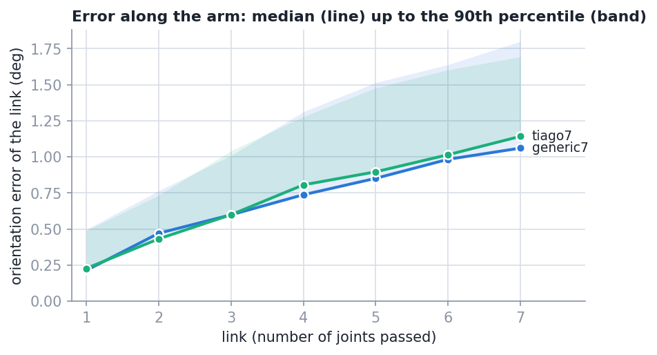
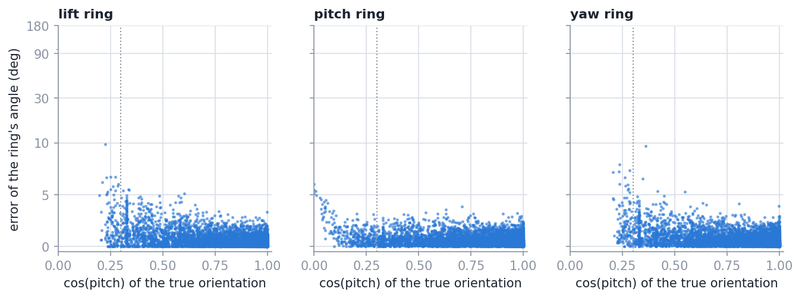
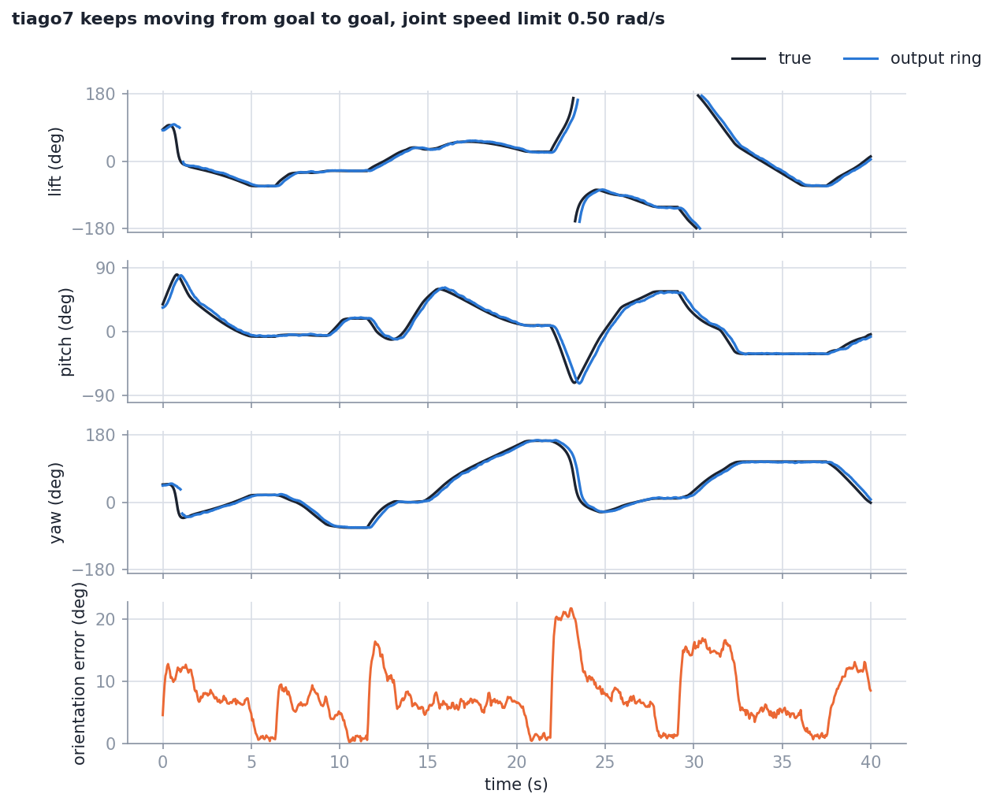
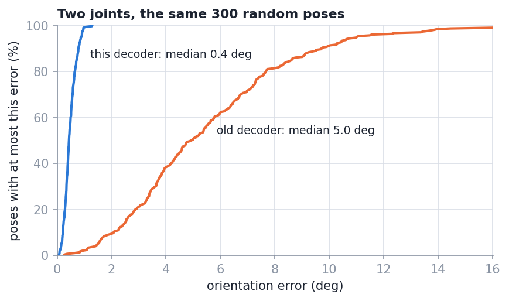
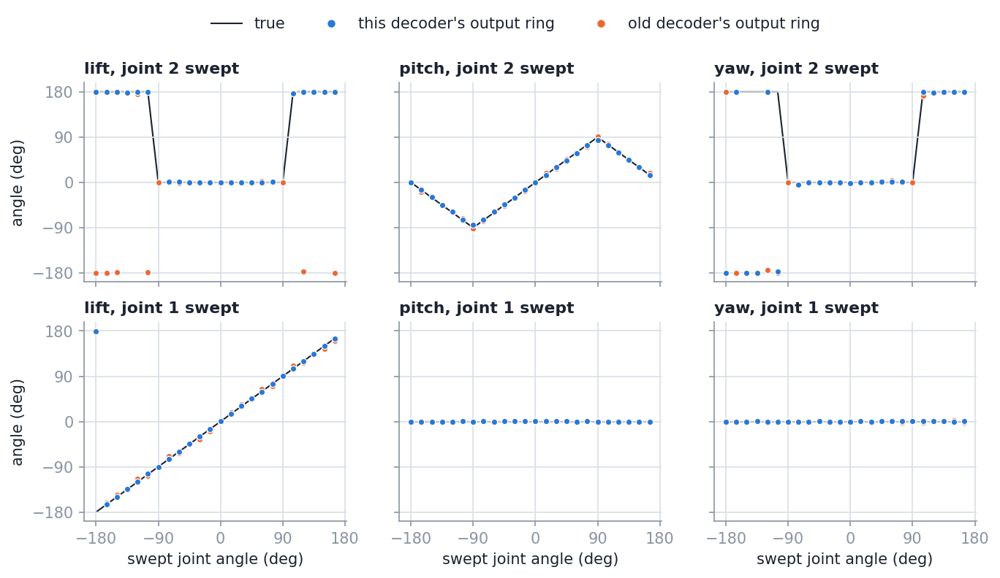
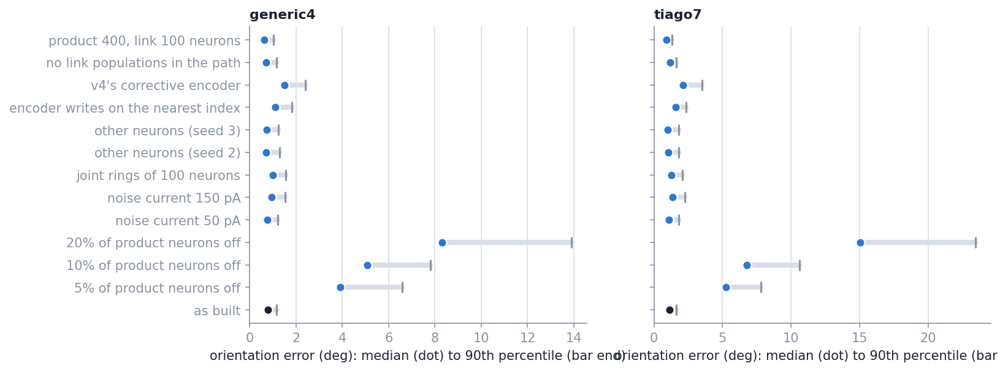
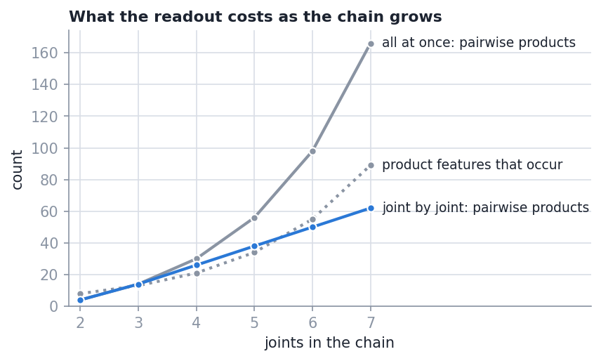
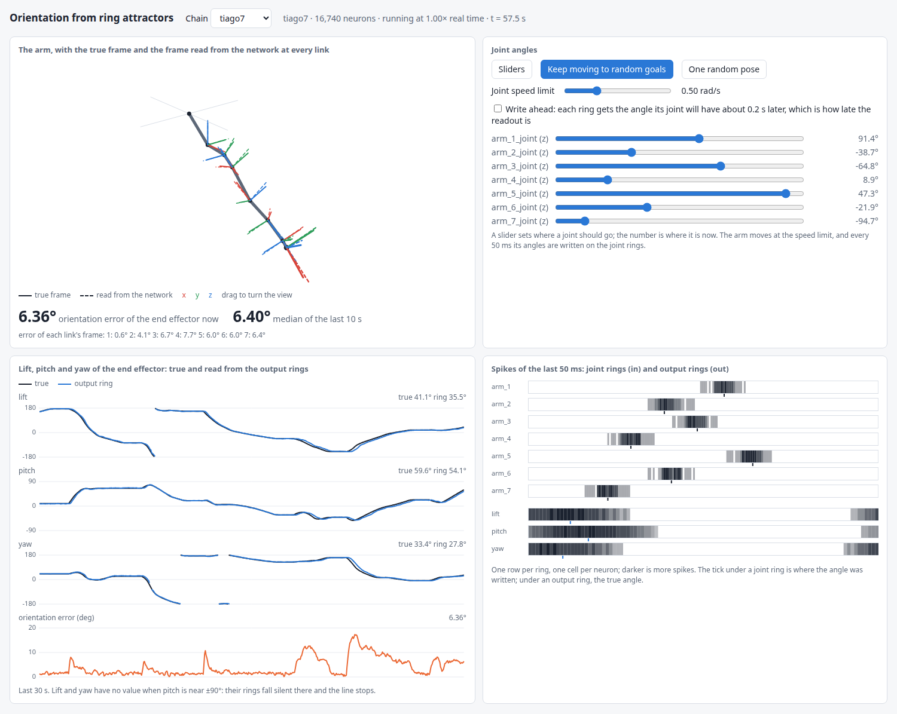
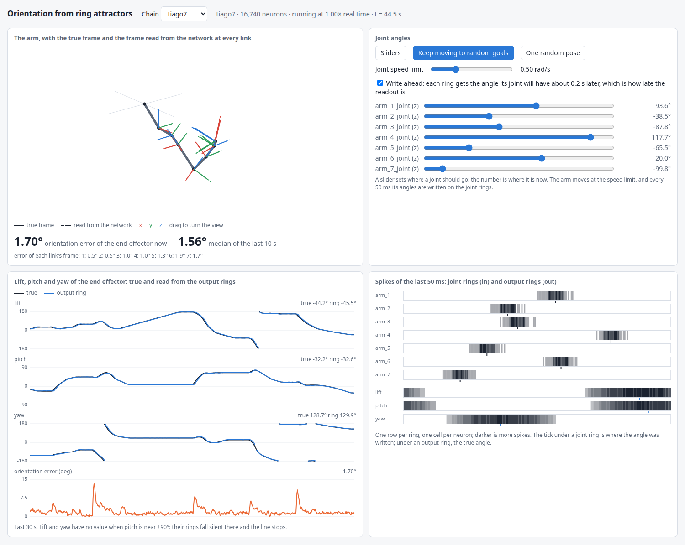

# Results: the orientation of the arm, read out from the joint rings

Date: 2026-10-05, branch `fk-chain`. NEST `HEAD@41892a5`, the pinned image, one machine
(AMD Ryzen 9 7900X). What the network is: [`architecture.md`](architecture.md). What each
test asks and its pass mark: [`tests.md`](tests.md). Every table in full:
[`results/tables.md`](results/tables.md); the data: [`results/data/`](results/data/README.md).
How to rerun any of it: the top-level [`README.md`](../README.md), section 3.

Orientation error is the angle of the single rotation that turns the decoded orientation
into the true one. Numbers are given as median / 90th percentile / largest.

## Summary

- **The readout gives the orientation, for 2 to 7 joints.** Over 300 random held poses per
  model the error of the end effector is 0.43° in the median for two joints and 1.06°
  (generic chain) and 1.14° (TIAGo arm) for seven. The largest 90th percentile of any model
  is 1.80° and the largest error of all 3,600 poses is 2.74°. All 12 models meet the mark set
  beforehand (median at most 5°, 90th percentile at most 10°). A readout that knows nothing
  would be 126.5° off.
- **Every link's orientation comes out too**, and the error grows slowly along the arm: 0.20°
  to 0.26° at the first link, then 0.12° to 0.14° more per joint.
- **It is better than the old two-joint decoder, with a ninth of the neurons.** On the same
  300 two-joint poses the old decoder is 4.96° / 9.72° / 18.78° off, this one 0.43° / 0.78° /
  1.29°, and this one is closer in 99% of the poses. It has 1,860 neurons; the old one 16,884.
- **The three output rings show lift, pitch and yaw**: where the angles are defined well
  (cos(pitch) > 0.3) no ring of any model is off by more than 2.37° at the 90th percentile.
  Near pitch = ±90° the lift and yaw rings fall silent; the matrix stays right.
- **It follows a moving arm 0.16 to 0.20 s behind.** At 0.5 rad/s per joint that delay is
  5.35° to 9.14° of orientation in the median. One second after the arm stops the error is
  back at 0.70° to 1.19°.
- **Computing all at once, as the paper writes it, gives the same** as joint by joint for 2
  and 3 joints; joint by joint needs fewer products from 4 joints on (62 instead of 166 at 7).
- **Writing each joint's angle a little ahead removes the delay** (an option, off by
  default): the 7-joint readout is then 0.03 s behind and 1.80° off while moving, where it
  is 6.85° off without. On goals that were not used to set the option: 1.87° against 7.14°.
- **Noise, smaller joint rings and other random neurons change little** (7 joints: 1.14° as
  built; 1.38° with a noise current of 150 pA; 1.29° with joint rings of 100 neurons; 1.03°
  and 0.98° with two other draws of the neurons).
- **It does not tolerate the loss of neurons.** With 5% of the product neurons switched off
  the 7-joint error is 5.25° / 7.79° / 15.27°, with 20% it is 15.02° / 23.43° / 30.35°. The
  weights are fitted to the neurons that are there; nothing re-fits them.
- **One pass mark of the parts was missed:** after one multiplying stage a vector's
  length is off by up to 4.7%, where 3% was asked. All other marks are met.

## 1. What was measured and how

| | |
| --- | --- |
| Models | `generic2` .. `generic7`: joints about x, y, z, x, y, z, x, angles on the whole circle (`generic2` is the paper's chain). `tiago2` .. `tiago7`: the first joints of the TIAGo arm with their real axes, link rotations and limits. |
| Network | joint rings of 200 neurons; per joint a cos / sin population of 120; product populations of 200; link-orientation populations of 60; output rings of 100. 1,860 neurons for two joints, 16,740 for seven. One calibration for all 12 models. |
| A held pose | the arm moves to the pose at up to 1 rad/s per joint, stays 1 s, the readout of the last 0.5 s is averaged |
| True orientation | the exact kinematics at the robot's joint angles |
| Test poses | uniform in the joint ranges, one fixed seed, first run after sizes, encoder and readouts were fixed |
| "Similar" | median at most 5° and 90th percentile at most 10°, set before the runs |

The robot is the light one of the simulator: joint angles that move toward a target at a
speed limit. No dynamics, no Gazebo.

## 2. The parts on their own (test 3)

Each part was measured in NEST on inputs its readout was not fitted on.

| Part | Result | Pass mark | Met |
| --- | --- | --- | --- |
| Cos / sin population, 80 ring positions between indices | cos and sin within 0.018; the pair's angle off by 0.17° in the median, 1.00° at most | within 0.03 | yes |
| Product population, 300 random pairs | root mean square error 0.0077, largest 0.041 | rms at most 0.02 | yes |
| Link-orientation population, 150 random values | root mean square error 0.0062, largest 0.026 | none set | |
| Length population for the pitch ring, 200 random pairs | root mean square error 0.0143, largest 0.043 | none set | |
| One stage, direction of the turned vector (64 vectors) | 0.30° in the median, 1.87° at most | within 2° | yes |
| One stage, length of the turned vector | off by up to 4.7% of its length | within 3% | **no** |

The joint ring itself holds the written position to -0.01 ring indices on average, with 0.35
indices of jitter from one 50 ms tick to the next (one index is 1.8° on a ring of 200).

The missed mark: the product population's largest errors lie at the corners of its input
range, and they set the worst case of the length. The worst case also moves from run to run
(3.3% to 4.7% over the runs made, which differ in the number of threads and so in the
random spike trains of the encoders). The sizes were not changed for it, because the
end-to-end mark below is met with a wide margin.

## 3. Held poses (test 4)

| Model | Error, median / p90 / max (deg) | 95% interval of the median | Within 5° |
| --- | --- | --- | ---: |
| generic2 | 0.43 / 0.78 / 1.29 | 0.41 - 0.47 | 100% |
| generic3 | 0.60 / 1.04 / 1.44 | 0.56 - 0.65 | 100% |
| generic4 | 0.77 / 1.22 / 2.06 | 0.71 - 0.81 | 100% |
| generic5 | 0.91 / 1.45 / 2.24 | 0.84 - 0.97 | 100% |
| generic6 | 0.97 / 1.57 / 2.48 | 0.93 - 1.03 | 100% |
| generic7 | 1.06 / 1.80 / 2.74 | 0.99 - 1.12 | 100% |
| tiago2 | 0.44 / 0.75 / 1.26 | 0.41 - 0.46 | 100% |
| tiago3 | 0.62 / 1.10 / 1.72 | 0.58 - 0.64 | 100% |
| tiago4 | 0.80 / 1.29 / 1.96 | 0.74 - 0.85 | 100% |
| tiago5 | 0.91 / 1.47 / 2.63 | 0.84 - 0.98 | 100% |
| tiago6 | 1.03 / 1.66 / 2.48 | 0.95 - 1.09 | 100% |
| tiago7 | 1.14 / 1.69 / 2.62 | 1.07 - 1.21 | 100% |

300 poses per model; the arm reached every pose. The two families behave alike: the TIAGo
arm's 90° link rotations and joint limits make no difference.

In the sweeps (one joint over its whole range, the others fixed) the largest error of any
model is 2.65° (`results/tables.md`, section 7): there is no bad region along a joint.

## 4. Along the arm (test 5)

Median error of each link's orientation (deg):

| Model | Link 1 | 2 | 3 | 4 | 5 | 6 | 7 |
| --- | ---: | ---: | ---: | ---: | ---: | ---: | ---: |
| generic7 | 0.21 | 0.47 | 0.60 | 0.74 | 0.85 | 0.98 | 1.06 |
| tiago7 | 0.23 | 0.43 | 0.60 | 0.81 | 0.90 | 1.01 | 1.14 |

Link 1 is the first joint's cos and sin alone. Every further joint adds 0.12° to 0.14°: less
than the errors would add up to if they all pointed the same way. The error of link k is the
same whether the chain ends there or goes on (compare `generic3` in section 3 with link 3
here), as it must be, since later joints do not feed back.

## 5. The output rings (test 6)

For the poses with cos(pitch) > 0.3, per ring and model, the error at the 90th percentile is
between 0.87° and 2.37° (`results/tables.md`, section 5). All models and poses pooled:

| cos(pitch) | Poses | Lift ring, median error (deg) | Yaw ring | Pitch ring | Matrix |
| --- | ---: | ---: | ---: | ---: | ---: |
| 0.8 - 1.0 | 2817 | 0.43 | 0.49 | 0.49 | 0.76 |
| 0.5 - 0.8 | 1364 | 0.64 | 0.66 | 0.59 | 0.78 |
| 0.3 - 0.5 | 559 | 1.08 | 1.00 | 0.63 | 0.78 |
| 0.2 - 0.3 | 162 | 1.42 (silent in 24%) | 1.69 | 0.72 | 0.70 |
| 0.1 - 0.2 | 95 | silent in 99% | silent | 0.97 | 0.77 |
| 0.0 - 0.1 | 43 | silent | silent | 2.88 | 0.59 |

Lift and yaw are not defined at pitch = ±90°. The pair of matrix entries that drives their
rings shrinks toward zero there, the rings get less sure and then fall silent. The pitch
ring keeps working, and the matrix does not notice the singular pose at all.

## 6. A moving arm (test 7)

The arm goes from one random goal to the next and rests 1 s at each.

| Model | Joint speed limit (rad/s) | Delay (s) | Error while moving, median / p90 (deg) | Error at rest, median / p90 (deg) | 1 s after a stop, median (deg) |
| --- | ---: | ---: | --- | --- | ---: |
| generic3 | 0.25 | 0.16 | 3.00 / 4.83 | 0.62 / 1.21 | 0.57 |
| generic3 | 0.50 | 0.16 | 5.77 / 9.48 | 0.68 / 1.15 | 0.70 |
| generic3 | 1.00 | 0.16 | 10.58 / 18.11 | 0.67 / 1.21 | 0.64 |
| generic7 | 0.25 | 0.20 | 4.80 / 8.32 | 1.14 / 1.87 | 1.09 |
| generic7 | 0.50 | 0.20 | 9.14 / 16.15 | 1.07 / 1.75 | 1.08 |
| generic7 | 1.00 | 0.20 | 16.26 / 30.87 | 1.13 / 1.81 | 1.35 |
| tiago3 | 0.25 | 0.17 | 2.91 / 4.73 | 0.73 / 1.37 | 0.64 |
| tiago3 | 0.50 | 0.16 | 5.35 / 9.14 | 0.78 / 1.36 | 0.78 |
| tiago3 | 1.00 | 0.17 | 9.96 / 17.52 | 0.67 / 1.37 | 0.71 |
| tiago7 | 0.25 | 0.20 | 3.88 / 8.06 | 1.08 / 1.69 | 1.20 |
| tiago7 | 0.50 | 0.20 | 6.85 / 15.63 | 1.14 / 1.62 | 1.19 |
| tiago7 | 1.00 | 0.20 | 12.59 / 30.08 | 1.12 / 1.63 | 0.93 |

- **The readout is right, but late.** The delay does not depend on the speed, so the error
  while moving is the delay times how fast the end effector turns. Compared with the true
  orientation one delay earlier, the 7-joint readout at 0.5 rad/s is 1.46° off, about what
  it is at rest.
- **Both pass marks are met**: the delay is under 0.5 s, and 1 s after a stop the error is
  back at the level of held poses in all 12 sessions.
- **Errors "at rest" here are single 50 ms readings**; a held pose in section 3 is the mean
  of ten, which is why it is a little lower.

Where the delay comes from (tiago7 at 0.5 rad/s):

| Variant | Delay (s) | Error while moving, median (deg) | Error at rest, median / p90 (deg) |
| --- | ---: | ---: | --- |
| as built | 0.20 | 6.85 | 1.14 / 1.62 |
| no link populations in the path | 0.18 | 6.32 | 1.03 / 1.68 |
| readout smoothed with 20 ms instead of 50 | 0.16 | 6.11 | 1.28 / 2.08 |
| both | 0.15 | 5.49 | 1.26 / 2.02 |

Shortening the path saves 0.05 s at most. The rest is upstream: a joint ring's bump trails
a moving angle by 0.09 s at every speed tried, and still by 0.07 to 0.08 s with an encoder
four times as strong (measured on a single ring, `results/tables.md` section 0); the
cos / sin population then reads the ring through a 15 ms synapse.

**Writing ahead.** Since the delay is the same at every speed, it can be taken out at the
input: each ring is given the angle its joint will have one delay later (its angle plus its
velocity times the delay; 0.14 s for the last joint and 0.01 s more for each joint before
it; never beyond a joint limit). This is the option `--lead`, off by default, and a switch
in the simulator.

| tiago7 at 0.5 rad/s | Delay (s) | Error while moving, median (deg) | Error at rest, median / p90 (deg) |
| --- | ---: | ---: | --- |
| as built | 0.20 | 6.85 | 1.14 / 1.62 |
| writing ahead | 0.03 | 1.80 | 1.10 / 1.59 |
| as built, other goals | 0.20 | 7.14 | 1.22 / 1.87 |
| writing ahead, other goals | 0.03 | 1.87 | 1.22 / 1.89 |

The two lead times were set from the first pair of runs, so the second pair (other random
goals) is the fair one; it gives the same. Limits: it was tried on one model at one speed;
it needs the joint velocity, which the light robot gives exactly and a real arm gives with
noise; and it is a correction at the input, the network itself is as slow as before.

## 7. All at once against joint by joint (test 8)

| Model | Joint by joint (deg) | All at once (deg) | Joint by joint closer | All at once closer | Sign test p |
| --- | --- | --- | ---: | ---: | --- |
| generic2 | 0.43 / 0.78 / 1.29 | 0.43 / 0.78 / 1.29 | 4% | 5% | 0.690 |
| generic3 | 0.60 / 1.04 / 1.44 | 0.60 / 1.01 / 1.54 | 55% | 45% | 0.094 |

The same 300 poses. For two joints the two versions are the same four products. For three
joints both need 14 products and there is no significant difference. So the paper's
readout, built with real products, works as written; joint by joint is how it stays
affordable (section 10).

## 8. Against the old two-joint decoder (test 9)

The old decoder is the frozen legacy code of the SO-2 repo with its stored weights. It gives
three angles; its orientation is the rotation built from them.

| Poses | This decoder (deg) | Old decoder (deg) | This closer | Old closer | Sign test p |
| --- | --- | --- | ---: | ---: | --- |
| 300 random poses | 0.43 / 0.78 / 1.29 | 4.96 / 9.72 / 18.78 | 99% | 1% | under 0.001 |
| the old decoder's own two sweeps (48 poses) | 0.61 / 0.83 / 1.05 | 3.19 / 5.48 / 6.71 | 92% | 8% | under 0.001 |

Each angle on its own, random poses with cos(pitch) > 0.3:

| | Lift (deg) | Pitch (deg) | Yaw (deg) |
| --- | --- | --- | --- |
| this decoder's output rings | 0.37 / 0.87 / 1.80 | 0.35 / 0.87 / 2.22 | 0.34 / 0.93 / 2.36 |
| old decoder's output rings | 2.75 / 7.31 / 29.21 | 1.80 / 6.17 / 15.09 | 2.10 / 7.50 / 27.53 |

The old decoder does well where it was fitted (its sweeps pass through its 16 x 16 grid of
training poses) and less well in between. This decoder has no training poses.

## 9. Variants and robustness (test 10)

The first 100 random poses, 4 and 7 joints. Median / p90 / max (deg):

| Variant | generic4 | tiago7 | Similar |
| --- | --- | --- | --- |
| as built | 0.80 / 1.16 / 2.06 | 1.14 / 1.62 / 2.17 | yes |
| 5% of the product neurons off | 3.91 / 6.59 / 9.14 | 5.25 / 7.79 / 15.27 | 4 joints yes, 7 **no** |
| 10% off | 5.07 / 7.80 / 11.77 | 6.75 / 10.62 / 23.56 | **no** |
| 20% off | 8.31 / 13.88 / 19.97 | 15.02 / 23.43 / 30.35 | **no** |
| noise current 50 pA in every neuron | 0.77 / 1.21 / 2.30 | 1.10 / 1.82 / 2.49 | yes |
| noise current 150 pA | 0.96 / 1.52 / 2.00 | 1.38 / 2.25 / 3.13 | yes |
| joint rings of 100 neurons | 1.00 / 1.57 / 2.81 | 1.29 / 2.07 / 2.82 | yes |
| other neurons (seed 2) | 0.73 / 1.30 / 1.95 | 1.03 / 1.82 / 3.14 | yes |
| other neurons (seed 3) | 0.73 / 1.25 / 1.77 | 0.98 / 1.83 / 2.32 | yes |
| no link populations in the path | 0.72 / 1.16 / 1.87 | 1.16 / 1.65 / 2.30 | yes |
| product 400 and link 100 neurons | 0.63 / 1.03 / 1.34 | 0.93 / 1.33 / 1.70 | yes |
| encoder writes on the nearest index | 1.12 / 1.84 / 3.33 | 1.57 / 2.36 / 3.61 | yes |
| v4's corrective encoder | 1.50 / 2.40 / 4.23 | 2.11 / 3.51 / 4.93 | yes |

- **Losing neurons is the weak point.** Each product is a weighted sum over 200 neurons whose
  weights were fitted with all of them present. Take 5% away and the sum is off by a
  constant that every later stage inherits. The error grows with the length of the chain.
  Nothing in the network re-fits the weights; a learning rule for them is future work.
- **Noise, ring size and the draw of the neurons matter little.** A noise current of 150 pA
  is 80% of the current that makes a neuron fire at all.
- **Twice the product neurons buys 0.14° to 0.21°**, at about twice the neurons in all.
- **The link populations cost nothing in accuracy** (no difference with them left out of the
  path) and 0.02 s of delay (section 6). They were kept because they hold each link's
  orientation as activity, which the translation stage of the SE(3) work reads.
- **The encoder was changed from the plan.** The plan named v4's corrective encoder (it
  writes on the nearest ring index, and only when the bump is off). Two others were built:

| tiago7 | Error (deg) | Rounding to an index alone, median (deg) | Rings read back, median (deg) |
| --- | --- | ---: | ---: |
| between indices, every tick (used) | 1.14 / 1.62 / 2.17 | 0.00 | 0.29 |
| nearest index, every tick | 1.57 / 2.36 / 3.61 | 0.95 | 0.96 |
| nearest index, only when the bump is off (v4) | 2.11 / 3.51 / 4.93 | 0.95 | 1.23 |

Rounding seven joints to ring indices costs 0.95° before any decoding. Writing between
indices (two neighbouring windows, blended) removes that, and the ring then holds the pose
to 0.29°. Each encoder has its own calibration.

## 10. Cost and speed

| Joints | Product features that occur | Pairwise products, all at once | Pairwise products, joint by joint | Neurons (joint by joint) |
| ---: | ---: | ---: | ---: | ---: |
| 2 | 8 | 4 | 4 | 1,860 |
| 3 | 13 | 14 | 14 | 4,420 |
| 4 | 21 | 30 | 26 | 7,500 |
| 5 | 34 | 56 | 38 | 10,580 |
| 6 | 55 | 98 | 50 | 13,660 |
| 7 | 89 | 166 | 62 | 16,740 |

A further joint costs 12 products and 3,080 neurons. The old decoder's design would need 32
times more cells for every further joint.

Speed, the network alone, 20 s of simulated time (`results/data/speed.json`):

| Joints | Neurons | Synapses | Simulated time per wall-clock time, 4 threads | 8 threads |
| ---: | ---: | ---: | ---: | ---: |
| 2 | 1,860 | 0.46 million | 8.1 | 9.3 |
| 3 | 4,420 | 1.1 million | 3.8 | 4.8 |
| 4 | 7,500 | 1.9 million | 2.1 | 2.9 |
| 5 | 10,580 | 2.6 million | 1.5 | 2.0 |
| 6 | 13,660 | 3.3 million | 1.1 | 1.5 |
| 7 | 16,740 | 3.9 million | 0.8 | 1.1 |

(Generic chains; the TIAGo chains are within 4% of them.) Up to six joints the network runs
faster than real time on 4 threads; seven joints need 8 threads for it, with little to
spare. The simulator runs the 7-joint network at real time on this machine.

## 11. The rate copy and the choice of sizes (test 2)

The rate copy (the same populations as constant firing rates) was run before the spiking
network, on 200 poses that are not the test poses, to choose the sizes:

| Model | Product 100, link 40 | Product 200, link 60 (chosen) | Product 400, link 100 |
| --- | --- | --- | --- |
| generic2 | 0.75 / 1.14 | 0.56 / 0.91 | 0.51 / 0.86 |
| generic4 | 1.70 / 2.72 | 1.29 / 1.85 | 1.10 / 1.84 |
| generic7 | 2.64 / 4.72 | 1.92 / 3.13 | 1.63 / 2.78 |
| tiago7 | 2.53 / 4.29 | 1.82 / 3.16 | 1.65 / 2.77 |

(Median / 90th percentile, deg.) The middle column met the marks with room to spare and
was kept. The spiking network then did better than its rate copy (7 joints: 1.06° against
1.92°). A likely reason, not isolated: the spiking readouts are fitted to measured rates,
and spikes arriving through synapses round off each neuron's sharp threshold, which a sum of
such neurons can then follow more closely.

## 12. The claims and what supports them

| Claim | Evidence | Limit |
| --- | --- | --- |
| The rings decode to the orientation of the end effector for 2 to 7 joints | section 3: medians 0.43° to 1.14°, largest 90th percentile 1.80°, largest error 2.74° over 3,600 poses, all 12 models within the mark | held poses of a light robot, one joint ring size, one machine |
| The same holds for the TIAGo arm's kinematics | section 3: `tiago7` 1.14° / 1.69° / 2.62°; the chain equals the URDF (unit test) | kinematics only: no Gazebo, no real robot |
| Every link's orientation is available | section 4: 0.20° to 0.26° at link 1, 0.12° to 0.14° more per joint | - |
| Joint by joint is the paper's readout | exact maths (unit test), and section 7: no significant difference from all at once for 2 and 3 joints | compared in spikes for 2 and 3 joints only |
| It improves on the old two-joint decoder | section 8: 0.43° against 4.96° in the median on the same 300 poses, closer in 99%, 1,860 against 16,884 neurons | the old decoder is two joints only; this is the one model on which they can be compared |
| The output rings show lift, pitch and yaw | section 5: 90th percentile at most 2.37° where cos(pitch) > 0.3 | not near pitch = ±90°, where lift and yaw have no value |
| The readout follows a moving arm | section 6: 0.16 to 0.20 s behind at every speed tried; back at the held level 1 s after a stop | while moving the error is the delay times the turning speed: 5.35° to 9.14° in the median at 0.5 rad/s |
| Writing the angles ahead removes the delay | section 6: delay 0.03 s and 1.80° while moving against 0.20 s and 6.85°; the same on other goals (1.87° against 7.14°) | one model, one speed; needs the joint velocity; the lead times were set from a measurement |
| Noise, smaller rings and other neurons change little | section 9: at most 1.38° in the median for 7 joints over these variants, against 1.14° as built | 100 poses, two models, one variant at a time |

Not claimed, because not supported: that the readout tolerates the loss of neurons (it does
not: section 9); that it
works at the joint speed limits of the real arm (up to 2.35 rad/s; tried up to 1 rad/s);
that anything here carries over to the real robot.

## 13. What to keep in mind

- **The robot is a light one.** Joint angles move at a speed limit; there are no dynamics,
  no sensor noise and no Gazebo. What is tested is the readout, not the arm.
- **A ring cannot follow a jump.** When an angle jumps across the ring two bumps coexist
  (measured). In every test the arm moves to a pose; it is never placed there.
- **The angle is written between ring indices.** That is this repo's encoder, not v4's
  (section 9 has both). With v4's corrective encoder the readout is still within the mark,
  but less exact.
- **Weights of both signs from one neuron.** As in the old decoder's fitted matrices. A
  version with separate excitatory and inhibitory neurons would need more populations.
- **One network, one seed for the main test.** Two more sets of neurons are in section 9.
- **Simulation only**, on one machine.

## 14. Recordings

In [`results/videos/`](results/videos/): the arm keeps moving from goal to goal while the
spiking network runs; left the arm with the true frame (solid) and the frame read from the
network (dashed) at every link, right the three angles and the error over time.

| File | Shows |
| --- | --- |
| `tiago7_goals.mp4`, `.png`, `.json` | the 7-joint TIAGo arm, 45 s, joint speed limit 0.5 rad/s |
| `generic3_goals.mp4`, `.png`, `.json` | the 3-joint generic chain, 30 s |

The page of the simulator (`scripts/simulator.py`; top-level [`README.md`](../README.md),
section 4) while the 7-joint network runs and the arm moves from goal to goal at 0.5 rad/s.
The error rises while the arm moves and falls back when it rests.

The same with "write ahead" switched on (section 6). The peaks that remain are the moments
at which the arm starts or stops: the velocity jumps there, and the angle written ahead
jumps with it.
